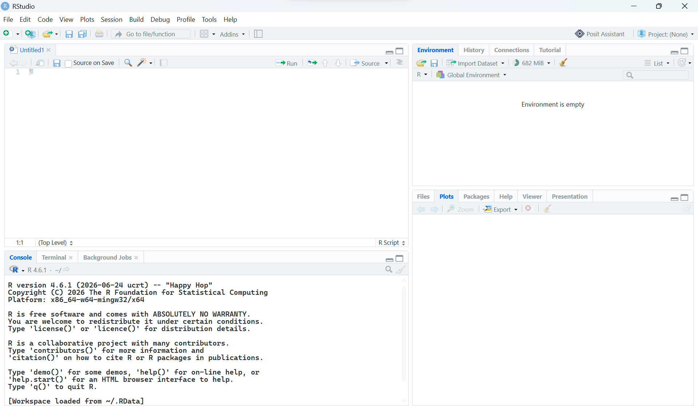

## What you'll learn

By the end of this chapter, you should be able to:

- explain the difference between **R** and **RStudio**
- install R and RStudio Desktop on Windows or macOS
- open RStudio and check that it is using the expected version of R
- create and open an RStudio Project for your analysis
- install an R package and load it into a session

::: {.callout-note}
## Before you start

You need a Windows PC or Mac to complete these tutorials R cannot easily be installed directly on a Chromebook, tablet or phone. If you do not have a suitable computer, contact a member of the teaching team to discuss available alternatives.

This course uses a **local installation** of R and RStudio rather than a browser-based version. A local installation gives you the same interface and file structure as the instructions and lets you work without relying on a web connection.
:::

## R and RStudio are different

**R** is the programming language and software that runs your analysis. **RStudio** is an integrated development environment (IDE): a user-friendly application for writing R code, running it, viewing plots, managing files, and getting help.

You need to install both, but you will normally open **RStudio**. RStudio uses R in the background. Installing RStudio without installing R first will not give you a working R setup.

## Install R

Download R from the [Comprehensive R Archive Network (CRAN)](https://cran.r-project.org/). Choose the download link for your operating system.

### Windows

1. Select **Download R for Windows**.
2. Select **base**.
3. Download the current Windows installer.
4. Open the downloaded installer and accept the standard options.

### macOS

1. Select **Download R for macOS**.
2. Download the installer package matching your macOS version and computer. The current CRAN page identifies the appropriate installer for Apple Silicon and Intel Macs.
3. Open the downloaded `.pkg` file and accept the standard options.

If you are using an older computer or operating system, read the compatibility information on the CRAN download page before choosing an installer. You do not need to open the standalone R application after installation.

## Install RStudio Desktop

Download [RStudio Desktop from Posit](https://posit.co/download/rstudio-desktop/). Choose the free RStudio Desktop download for your operating system.

1. Download the installer.
2. Open it and accept the standard installation options.
3. Start RStudio from the Start menu or desktop shortcut on Windows, or from Applications/Finder on macOS.

R must be installed before RStudio. If RStudio opens but cannot find R, restart RStudio after installing R and check the troubleshooting section below.

## Check that the installation works

When RStudio opens, the **Console** pane should be visible. Click in the Console, type the following line, and press Enter:

```{r}
1 + 1
```

The Console should display `2`. Now check the R version:

```{r}
R.version.string
```

You can also check which R executable RStudio is using:

```{r}
R.home()
```

The exact version number and folder will differ between computers. The important result is that R returns a version and a folder path rather than an error.

::: {.callout-tip title="If you get stuck"}
Take a screenshot or copy the complete error message, including the command that caused it. The full message usually gives more useful information than a description such as "R does not work". Do not repeatedly reinstall packages before checking the error.
:::

## Understand the RStudio layout

RStudio is usually divided into four panes:

- **Source**: write and save scripts and Quarto documents
- **Environment**: inspect objects currently held in memory
- **Console**: run commands and read output
- **Files, Plots, Packages, Help**: browse files, view figures, manage packages, and read documentation

The Source pane may not appear until you open a script. That is normal. Open one with **File > New File > R Script**.

To run the current line or a selected block from a script:

- Windows: press `Ctrl + Enter`
- macOS: press `Command + Enter`



## Create a project for this course

For these tutorials, create an **RStudio Project** and choose a location on your device where you can easily find it again (e.g. Documents or Home). Using a project keeps all of your scripts, data files and output files together in one place. It also sets R to look for files within the project folder automatically (relative file paths), so you do not need to specify their full location on your computer. This makes your code easier to share and move between computers, and less likely to produce "file not found" errors.


{width="50%"}

When the project is open, its name appears near the top right of RStudio. Open the `.Rproj` file or select the project from RStudio's recent-projects menu when you return to it. Open the project before opening a script so that relative file paths work as expected.


## Before you start

Download the data files below and place them into your project folder:

- [`m_sample_counts.csv`](m_sample_counts.csv)
- [`m_sample_info.csv`](m_sample_info.csv))
- [`human_annotations_from_orgHs.csv`](human_annotations_from_orgHs.csv))

A typical project structure might look like:

```text
HAT_analysis/
├── HAT_analysis.Rproj
├── human_annotations_from_orgHs.csv
├── m_sample_counts.csv
└── m_sample_info.csv
```

## Setting up your project folder

Every analysis needs organised output folders to help with reproducibility and reporting. For these tutorials, we need to create some results folders in our main project folder called tables, figures and objects. You can do this in Windows Explorer or Mac Finder, or you can even use R:

::: {.callout-tip title="Run this setup code"}
The following statements create the folders required later in the chapter Run them from your script, but you do not need to understand or memorise every argument yet.

:::

```{r}
dir.create("tables", showWarnings = FALSE)
dir.create("figures", showWarnings = FALSE)
dir.create("objects", showWarnings = FALSE)
```

These statements check if the folders already exist (if they do, they won't complain) and create them if they don't. The `showWarnings = FALSE` prevents "folder already exists" messages from cluttering your console. You can run this  code to create the output folders but you do not need to memorise or reproduce it independently.

Your project should now look something a bit like this:
```text
HAT_analysis/
├── figures/
├── tables/
├── objects/
├── HAT_analysis.Rproj
├── human_annotations_from_orgHs.csv
├── m_sample_counts.csv
└── m_sample_info.csv

```

::: {.callout-important}
## Keep data and code organised

For the HAT tutorials, keep the data files in the project folder used by the workbook. Do not rename the supplied files unless you also update the code. Avoid opening CSV files in Excel and saving them again: Excel can change identifiers, formatting, or missing values.
:::

## Set useful RStudio defaults

R objects exist only in the current session unless you save them explicitly. To make analyses easier to reproduce:

1. Open **Tools > Global Options** on Windows, or **RStudio > Settings** on macOS.
2. In the General settings, set **Restore most recently opened project at startup** according to your preference.
3. Set **Save workspace to .RData on exit** to **Never**.
4. Turn off **Restore .RData into workspace at startup** if it is available.

Save your scripts and exported results, not an automatically saved workspace. Starting with a clean session makes it easier to tell which objects your code actually creates.

## Install an R package

R includes many basic functions, but specialist analyses use additional **packages**. Install a package once, from the Console:

```{r}
#| eval: false
install.packages("ggplot2")
```

Load it at the start of each new R session:

```{r}
library(ggplot2)
```

Do not put `install.packages()` in an analysis script that you will run repeatedly. It is an installation step, not an analysis step.

The following code will install all the libraries we will need in these tutorials, you just need to run it once:

```{r}
#| eval: false
install.packages("ggplot2")
install.packages("ggrepel")

```

Many bioinformatics packages are distributed through Bioconductor. This is a specialist software repository for genomic, transcriptomic, proteomic and other biological data analysis tools. It provides a large collection of interoperable packages that are widely used in modern bioinformatics workflows.

To install Bioconductor packages, we first install the BiocManager package from CRAN. We can then use BiocManager::install() to install packages (e.g. DESeq2).

```{r}
#| eval: false
install.packages("BiocManager")
BiocManager::install("DESeq2")
```

As with CRAN packages, installation only needs to be performed once. After installation, load the package at the start of each R session:
 
```{r}
library(DESeq2)
```

::: {.callout-warning}
Package installation needs an internet connection and may take a few minutes. If R asks you to choose a download mirror, choose a location near you or accept the default. If installation fails, keep the complete error message and check whether the package name was typed correctly.
:::

## First-session checklist

Before starting Chapter 2, confirm that:

- R and RStudio Desktop are installed
- RStudio opens without an R error
- `1 + 1` returns `2`
- `R.version.string` returns a version
- you have created and opened the course RStudio Project
- you know where the project folder is stored
- you have downlaoded the required files and created the output folders
- you can create an R script and run a line with the appropriate shortcut

## Troubleshooting

**RStudio says that R cannot be found**  
Close and reopen RStudio. If the problem remains, check that base R was installed separately and that you downloaded the installer for your operating system.

**A package says it is not available**  
Check your internet connection, R version, and spelling. Some packages do not support very old versions of R.

**My data file cannot be found**  
Open the correct `.Rproj` file first, then run `getwd()` and `list.files()` in the Console. The data file must be in the project folder or in the relative subfolder used by the code.

**I do not have permission to install software**  
Use a University computer or contact local IT support. Do not download unofficial copies of R or RStudio.

## Summary

R is the language that runs the analysis; RStudio is the interface used to work with R. Install R first, install RStudio Desktop second, create a project, and keep your scripts and data organised inside it. In the next session , we will use this setup to import and inspect the HAT dataset.
