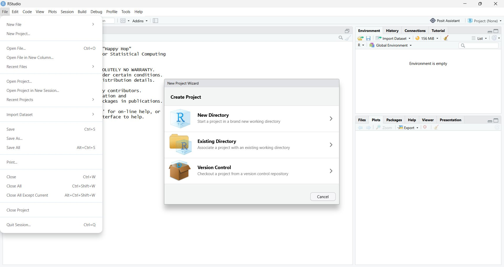
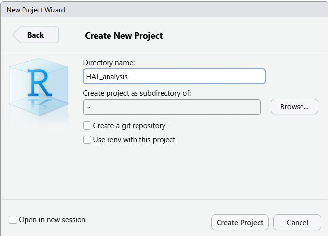
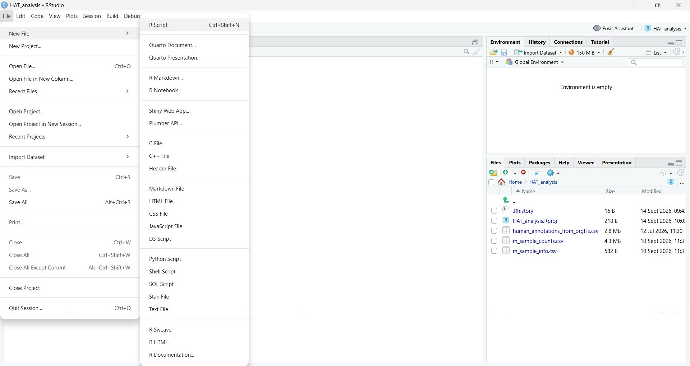
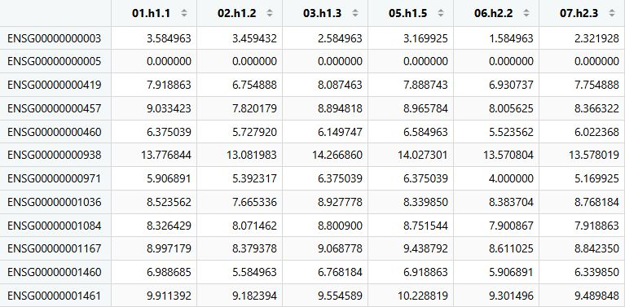
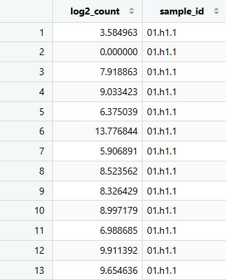

# Getting Started with the HAT Dataset

## What you'll learn

In this tutorial, we'll learn the basics of working with biological data in R and begin to make figures using a package called ggplot2. You'll import count data and metadata, explore the structure of the files and understand the experimental design behind our HAT dataset.

::: {.callout-note}
## Learning outcomes
By the end of this chapter you should be able to:

- explain what the rows, columns, and values in a count matrix and a metadata table represent
- import CSV files and inspect the resulting matrix and data frame
- select data by position, by row/column name, and by logical condition
- check that sample metadata is aligned with the columns of a count matrix
- calculate simple sample-level quality-control summaries
- create and save a basic `ggplot2` figure

**ISCB alignment:** B3 (prepare life-science data for computational analysis), E3 (manage data with clear names and a reproducible folder structure), H3 (use basic R syntax, indexing, factors and plotting functions).
:::

## Before you start

For these tutorials, create an **RStudio Project** and choose a location on your device where you can easily find it again (e.g. Documents or Home). Using a project keeps all of your scripts, data files and output files together in one place. It also sets R to look for files within the project folder automatically (relative file paths), so you do not need to specify their full location on your computer. This makes your code easier to share and move between computers, and less likely to produce "file not found" errors.

{width="50%"}

Inside your project folder, make sure you have:

- The data files from Moodle (`m_sample_counts.csv` and `m_sample_info.csv`) downloaded and saved into your project folder.
- Installed all the required packages (see the [previous chapter](chapter01.qmd)).

A typical project structure might look like:

```text
HAT_analysis/
├── HAT_analysis.Rproj
├── m_sample_counts.csv
└── m_sample_info.csv
```

## Setting up your project folder

Every analysis needs organised output folders to help with reproducibility and reporting. For these tutorials, we need to create a results folder in our main project folder and then a tables and figure folder within that. You can do this in Windows Explorer or Mac Finder, or you can even use R:

```{r}
dir.create("results", showWarnings = FALSE)
dir.create(file.path("results", "tables"), recursive = TRUE,
           showWarnings = FALSE)
dir.create(file.path("results", "figures"), recursive = TRUE,
           showWarnings = FALSE)
```

These commands check if the folders already exist (if they do, they won't complain) and create them if they don't. The `showWarnings = FALSE` prevents "folder already exists" messages from cluttering your console.

Your project should now look something a bit like this:
```text
HAT_analysis/
├── HAT_analysis.Rproj
├── m_sample_counts.csv
├── m_sample_info.csv
└── results/
    ├── figures/
    └── tables/
```
## Creating an analysis script

Before we begin importing data, create a new R Script and save it in your project folder with an understandable filename (e.g. HAT_analysis.R). You can do this by selecting: File → New File → R Script and then saving the file in your project folder.



Why do this? Every command that you run during an analysis should be recorded in a script. This is a key component of reproducible research. A good analysis should be understandable and repeatable by both you and other researchers. Although it is possible to work interactively by typing commands directly into the console, those commands are easily lost once RStudio is closed.

By saving your code in a script, you create a permanent record of:

- How the data were imported
- How the data were processed
- Which statistical analyses were performed
- How tables and figures were generated

Over the course of these tutorials, you will build up your script to create a complete record of your analysis workflow. Make sure you save your script often to avoid losing any work.

## Importing and inspecting data files

The first step in any analysis is getting your data into R. We have two files:

1. **Count data** (`m_sample_counts.csv`): rows are genes labelled with stable [Ensembl IDs](https://mart.ensembl.org/info/genome/stable_ids/index.html), columns are samples and each cell is the number of RNA-seq reads mapped to that gene in that sample
2. **Sample metadata** (`m_sample_info.csv`): rows are samples, columns are variables (e.g. disease status, sex, age)

::: {.callout-tip title="Try it yourself: predict before you import"}
Open `m_sample_counts.csv` and `m_sample_info.csv` in a text editor  before running any R code (you can also use Excel but do not overwrite the original .csv files).

1. Which column do you think will become the row names of each table once loaded into R?
2. Are the values in `m_sample_counts.csv` whole numbers or decimals? Why might that matter for later analysis?
3. How many metadata columns does `m_sample_info.csv` have, and which one records the treatment group?
:::

Now, let's load these files into RStudio. We could use the **Import Dataset** menu item but as we want our workflow to be recorded and reproducible, it would be best to use the script window. Let's load in the patient metadata first.

```{r}
sample_info <- read.csv(
  "m_sample_info.csv",
  header = TRUE,
  row.names = 1,
  check.names = FALSE
)
```
To actually run this code, place the cursor anywhere inside the complete command and click **Run**, or select all lines of the command and click Run. In RStudio, you can also use Ctrl + Enter. If the console displays + instead of >, R is usually waiting for the rest of an incomplete command, often because a closing parenthesis or quotation mark is missing.

::: {.callout-tip title="Multi-line commands"}
This command could also be written on a single line as `sample_info <- read.csv("m_sample_info.csv",header = TRUE,row.names = 1, check.names = FALSE)` but R commands do not have to fit on a single line. If R reaches the end of a line while the parentheses **(** is still open, it will continue until it reaches the matching closing parenthesis **)**. A useful style that helps with readability is to place the opening function call on the first line, indent each argument and place the closing parenthesis on its own line.

:::

**What just happened:**

- `read.csv()` reads a CSV file into an R data frame object
- `header = TRUE` means the first row contains column names
- `row.names = 1` means the first column becomes the row names (gene IDs or sample IDs)
- `check.names = FALSE` keeps your gene/sample names exactly as they are, rather than letting R "fix" them. This can lead to issues with sample name mismatches

::: {.callout-tip title="Try it yourself: Data import practice"}

How would you import the sample count data into a data-frame object called **`count_data`**?

:::

::: {.callout-tip title="Show solution" collapse="true"}

```{r}
count_data <- read.csv(
  "m_sample_counts.csv",
  header = TRUE,
  row.names = 1,
  check.names = FALSE
)
```

:::

**Convert the count data to a matrix**

There is now an additional step we have to do to the count data due to some quirks in R and the tools we will be using in the workflow. **read.csv()** imports the sample counts as a **data frame**, which is useful for storing tabular data because different columns can contain different types of information. For example, one column could contain numbers, another text and another categories etc. You can think of it like an Excel worksheet. However, many downstream tools expect the data to be just one type (e.g numbers) so they can make various assumptions to speed up analysis. R has a special type of object called a **matrix** to store these single-type data. To convert count_data into a matrix, use:
```{r}
count_data <- as.matrix(count_data)
```
Note that we are overwriting the original data frame with the matrix so be careful when using this command.

**Final Checks**

Before continuing, we need to check that the count data and sample information describe the same samples (mismatches are a surprisingly common issue when dealing with multiple files).

### Row names and column names

R objects can have names attached to their rows and columns:
- `rownames()` retrieves the row names of an object
- `colnames()` retrieves the column names of an object
In `sample_info`, each row describes one sample. The sample identifiers are therefore stored as its row names:
```{r}
rownames(sample_info)
```
In `count_data`, each column contains the gene counts for one sample. The sample identifiers are therefore stored as its column names:
```{r}
colnames(count_data)
```
This means that the two sets of sample identifiers we need to compare are:

```r
rownames(sample_info)
colnames(count_data)
```

### Checking that the same samples are present

We could compare the sample identifiers manually, but R provides functions that can do this more reliably.

It is good practice to check that the sample names line up between the two files *before* doing anything else. We could do this manually but there are commands in R to help do this. For example, setequal can check if two objects contain the same elements:

```{r}
setequal(rownames(sample_info), colnames(count_data))
```

If this is `FALSE`, stop and investigate. Every downstream step depends on samples being correctly matched between the count matrix and the metadata. We can also verify that the sample order in the count data and sample info are in the same order by are identical to the column names of count_data using `identical()`.

```{r}
identical(rownames(sample_info), colnames(count_data))
```

## Understanding data structure
Before analysing the data, we should also check that the files have been imported in the way we expected. These checks help us understand how the data are organised and can reveal import problems before they affect later analyses.

This can be as simple as making sure all the data has imported properly and is as we expect. For example, the `dim()` function reports the number of rows and columns in an object. For `count_data`, the rows represent genes and the columns represent samples. For `sample_info`, the rows represent samples and the columns contain information describing those samples.

Checking the dimensions helps us answer questions such as:
- How many genes are included in the count data?
- How many samples are included?
- Does the number of metadata rows match the number of count-data columns?

::: {.callout-tip title="Try it yourself: predict before running"}
Before running the code, answer:

1. Which object should have genes as rows?
2. Which object should have samples as rows?
3. Which dimension of count_data should match the number of rows in sample_info?
4. Do you expect the two objects to have the same dimensions? Explain your answer.

:::

Run the commands and compare the results with your predictions.
```{r}
# Dimensions are reported as: rows, columns
dim(count_data)
dim(sample_info)
```
We can also check the names attached to the rows and columns. This allows us to confirm that:
- the rows of `count_data` are labelled with gene identifiers
- the columns of `count_data` are labelled with sample names
- the columns of `sample_info` contain the expected metadata variables

Meaningful row and column names are important because they allow us to refer to genes, samples and metadata variables by name rather than relying only on their positions.
```{r}
# Display the first five gene identifiers
head(rownames(count_data), 5)

# Display the sample names in the count data
colnames(count_data)

# Display the metadata variable names
colnames(sample_info)
```
## Adding comments to R code

You may have noticed that some lines in the code begin with a hash symbol, `#`. These lines are called **comments**.

R ignores everything after `#` on that line. Comments are written for people reading the code and are not treated as instructions for R.

Comments can help us:

- explain the purpose of a section of code
- record why an analytical decision was made
- make a script easier to navigate
- help someone else understand and reuse our analysis
- remind our future selves what the code was intended to do

A useful comment normally explains **why** a command is being run or what a group of commands is intended to achieve. It should not simply repeat something that is already obvious from the code.

For example, this comment is not especially helpful:

```r
# Use dim on count_data
dim(count_data)
```

This version better explains the purpose of the command:

```r
# Confirm the number of imported genes (rows) and samples (columns) 
dim(count_data)
```

Comments should be useful but concise. Too many comments can make a script harder to read, particularly when every simple command has a comment that merely repeats the code.

::: {.callout-tip title="Try it yourself: Commenting practice"}
Think of some comments to add to your previous import and as.matrix code that would be useful to explain what they are doing and why.

:::

## Indexing and Subsetting

Modern biological datasets can contain thousands of variables (e.g. genes) and samples. We don't always want to examine or analyse every value at the same time. Instead, we often need to select:

- one particular gene
- a group of genes
- one or more samples
- a metadata variable, such as status group
- samples or genes that meet a particular condition

Selecting part of an R object is called **subsetting** and **Indexing** tells R which rows, columns, or individual values we want to select. For a matrix or data frame, values are selected using square brackets:

```r
object[rows, columns]
```

The comma separates the row selection from the column selection:

- before the comma specifies the rows
- after the comma specifies the columns
- leaving one side empty means selecting all rows or all columns

This can be difficult to follow at first, so let's practice on a smaller dataset that just has two genes and three samples. 

```{text}
        sample_1 sample_2 sample_3
gene_A    5         0         8
gene_B    2         4         1
```

### Selecting data by position

We can select rows and columns according to their numerical positions.

::: {.callout-tip title="Try it yourself: predict what will happen"}
For each expression, predict what will be displayed from the small matrix:

- the values returned
- whether the result contains one value or several values
- which biological observations those values represent

```{r}
#| eval: false
small_matrix[1, ]
small_matrix[, 2]
small_matrix[2, 3]
small_matrix[1:2, 2:3]
```
:::

::: {.callout-tip title="Show solution" collapse="true"}

Compare the outputs with your prediction. If they differ, identify whether the problem involved the row position, column position, comma, or use of a name.

```{text}
small_matrix[1, ]
       sample_1 sample_2 sample_3
gene_A        5        0        8

small_matrix[, 2]
 0 4

small_matrix[2, 3]
 1

small_matrix[1:2, 2:3]
       sample_2 sample_3
gene_A        0        8
gene_B        4        1
```
:::

Lets try it out on the main sample count set:

```{r}
# Select the first gene of all samples
count_data[1, ]

# Select the first gene of the third sample
count_data[1, 3]

# Select the first gene of the first three samples
count_data[1, 1:3]

# Select the first five genes of the first three samples
count_data[1:5, 1:3]
```

In the first command, `1` selects the first row and the blank space means all the columns are selected.
```r
count_data[1, ]
```

In the second command, `1` selects the first row and `3` selects the third column. 
```r
count_data[1, 3]
```

In the third command, `1:3` creates the sequence 1, 2, 3. The command therefore selects the first gene and the first three sample columns:

```r
count_data[1, 1:3]
```

The final command selects several rows and several columns, producing a smaller matrix called a **submatrix**:

```r
count_data[1:5, 1:3]
```

Selecting by position is useful when exploring a dataset. However, positions can change if rows or columns are added, removed or rearranged, so be careful.

### Selecting data by name

We can also select rows and columns using their names.

::: {.callout-tip title="Try it yourself: predict what will happen"}
For each expression, predict what will be displayed from the small matrix:

- the values returned
- whether the result contains one value or several values
- which biological observations those values represent

```{r}
#| eval: false
small_matrix["gene_B", ]
small_matrix[, "sample_3"]
small_matrix["gene_B", "sample_2"]

```
:::

::: {.callout-tip title="Show solution" collapse="true"}

Compare the output with your prediction. If they differ, identify whether the problem involved the row position, column position, comma, or use of a name.

```{txt}
small_matrix["gene_B", ]
       sample_1 sample_2 sample_3
gene_B        2        4        1

small_matrix[, "sample_3"]
8 1

small_matrix["gene_B", "sample_2"]
4
```
:::

Lets try it out on the main sample counts data set. For example, ENSG00000100342 is the Ensembl identifier for the gene APOL1. We can use this identifier to retrieve the counts for APOL1 across all samples.

```{r}
count_data["ENSG00000100342", ]
```

Selecting by name is usually safer and clearer than selecting by position. The gene may not always remain in the first row, but its identifier should continue to refer to the same gene.

### Selecting columns from a data frame

The columns of a data frame can also be selected by name. This command shows the first five genes for patient **shi.1**.

```{r}
# Select the first five genes of sample 11.shi.1
count_data[1:5, "shi.1"]
```

The $ operator  can also be used to select a named column from a data frame like sample_info but it cannot be used to select from a matrix like sample_counts. For example, to show the age column of sample_info

```r
sample_info$age
```

Both approaches are common in R. The square-bracket form is particularly useful when you want to select several columns or select column names stored in another object.

::: {.callout-tip title="Try it yourself: indexing practice"}
Using the objects `count_data` and `sample_info`, write and run code to display:

1. the tenth gene, across every sample
2. the first five genes for one sample, chosen by its **name** rather than its position
3. only the samples younger than 30 years old (Hint: you can use operators like <, > and = to subset)
4. Which indexing method (by position or by name) do you think is safer if the column order in a new dataset changes?

Try this without looking back first but if you get stuck, refer to the previous examples or open the solution below.

::: {.callout-tip title="Solution" collapse="true"}
```{r}
#| eval: false
# show the tenth gene, across every sample
count_data[10, ]

# show the first five genes for a sample (e.g. h1.1), chosen by name rather than position
count_data[1:5, "h1.1"]

# samples younger than 30 years old
sample_info[sample_info$age < 30, ]
```
Indexing by **name** is usually safer, because it does not depend on columns being in a particular order. If a new dataset arrives with the columns rearranged, `sample_info$status` still finds the right column, but `sample_info[, 2]` might not.

:::

:::

## Understanding the experimental design

We can use the table command with subsetting to help understand the design of the experiment. For example, to see a summary of the status of different groups in our data set:

```{r}
table(sample_info$status)
```

Our dataset has **three groups**: control, SERO TL+ (asymptomatic carriers), and HAT (symptomatic carriers). For a lot of these analyses, we will be focusing on comparing HAT versus SERO TL+, but the control samples remain in every table to help with various analyses and will be examined in the later stages of the workflow.

::: {.callout-tip title="Try it yourself: more indexing practice"}
What command could you use to summarise the sex data for the sample info? Try this without looking back first but if you get stuck, refer to the previous example or open the solution below.

Why do you think it has this distribution?

::: {.callout-tip title="Solution" collapse="true"}
```{r}
#| eval: false
table(sample_info$sex)
```
For this initial analysis, we are only focusing on male samples. Possible reasons for analysing a single sex might include a sampling limitation, reducing biological variation and avoiding potential confounding between sex and disease status. We will return to the complete dataset later to explore the effect of sex and consider how including it changes the analysis.

- What could happen if sex affects gene expression but is ignored during the analysis?
- Can results from the male-only analysis automatically be generalised to female participants?

:::

:::

## Sample quality metrics

Before carrying out differential-expression analysis, we will calculate some basic summary statistics for every sample to examine the quality of our data. Remember:

**Garbage In, Garbage Out**.

These simple statistics provide an initial overview of the sequencing data before we start to modify the data for analysis and can help us identify samples that may have received substantially more or less sequencing than the others, or samples in which comparatively few genes were detected. Any major differences may skew the resulting expression profile. These summaries do not tell us whether a sample should be removed but can help us identify samples that may need further investigation.

### Creating a sample-summary table

We already have the information needed to calculate these summaries, but it is currently spread across two objects:

- `count_data` contains the gene counts for each sample
- `sample_info` contains information describing each sample

We will combine selected information from these objects into a new data frame called `sample_summary`.

```{r}
sample_summary <- data.frame(
  sample_id = colnames(count_data),
  status = sample_info[colnames(count_data), "status"],
  total_counts = colSums(count_data),
  detected_genes = colSums(count_data > 0)
)
```
**What just happened:**

The assignment operator saves the new data frame as an object called `sample_summary`:

```r
sample_summary <- data.frame(...)
```

The `data.frame()` function creates a table from several objects that are of equal length. Each named argument becomes a column in the new table.

In `sample_summary`:

- each **row** represents one sample
- each **column** contains a different piece of information about that sample

Let's examine how each column is created.

### Sample identifiers

```r
sample_id = colnames(count_data)
```

The samples are stored in the columns of `count_data`. `colnames(count_data)` retrieves their identifiers and places them in a new column called `sample_id`.

### Sample status

```r
status = sample_info[colnames(count_data), "status"]
```

This retrieves the `status` value for each sample from `sample_info`.

The sample names from `count_data` are used to select and order the rows of `sample_info`. This ensures that the status values appear in the same order as the count-data columns.

This is important because every row of `sample_summary` must describe the correct sample.

### Total counts

```r
total_counts = colSums(count_data)
```

The `colSums()` function adds together all values in each column.

Because each column of `count_data` represents one sample, this calculates the total number of counts recorded for each sample. This total is often referred to as the sample's **library size**.

Samples with larger library sizes generally received more sequencing information than samples with smaller library sizes. Differences in library size are common and will later be addressed during normalisation.

### Detected genes

```r
detected_genes = colSums(count_data > 0)
```

This calculation takes place in two stages.

First:

```r
count_data > 0
```

tests every value in the count matrix. R returns:

- `TRUE` when a gene has a count greater than zero
- `FALSE` when a gene has a count of zero

The result is a logical matrix containing `TRUE` and `FALSE` values.

Next:

```r
colSums(count_data > 0)
```

adds the `TRUE` values in each sample column. When values are added, R treats `TRUE` as 1 and `FALSE` as 0.

The result is therefore the number of genes with at least one count in each sample.

This provides a simple measure of how many genes were detected, although a count greater than zero does not necessarily indicate strong or biologically meaningful expression.

### Inspecting the summary table

Display the first six rows of the completed table:

```{r}
head(sample_summary)
```

You should see one row per sample and four columns:

- `sample_id`
- `status`
- `total_counts`
- `detected_genes`

We can also confirm the dimensions and structure of the new object:

```{r}
dim(sample_summary)
str(sample_summary)
```

The number of rows should equal the number of samples in `count_data`.

We can verify this directly:

```{r}
nrow(sample_summary) == ncol(count_data)
```

The expected result is `TRUE`.

### Saving the summary table

The `sample_summary` object currently exists in the R Environment. Unless it is saved, it will not exist as a separate file outside the current R session.

We will save the table as a CSV file so that it can be:

- opened in spreadsheet software
- inspected without rerunning the analysis
- used in later parts of the workflow
- shared as a record of the sample-level quality summaries

```{r}
write.csv(
  x = sample_summary,
  file = "results/tables/sample_summary.csv",
  row.names = FALSE
)
```

The arguments specify:

- `x = sample_summary`: the object that we want to save
- `file = ...`: the location and filename of the saved table
- `row.names = FALSE`: do not add R's numerical row names as an extra column

The file will be saved as:

```text
HAT_analysis/
└── results/
    ├── figures/
    └── tables/
        └── sample_summary.csv
```

Saving the table does not remove `sample_summary` from the R Environment. We can continue to inspect and use the object during the analysis.

::: {.callout-note}
## A summary is not a conclusion

A sample with fewer total counts or fewer detected genes is not automatically a poor-quality sample.

Differences may be caused by:

- sequencing depth
- technical variation
- properties of the original biological sample
- genuine biological differences between groups

These metrics should therefore be considered alongside the quality-control plots and other information about the experiment.

:::

::: {.callout-tip}
## Check your understanding

Use `sample_summary` to answer the following questions:

1. How many rows and columns does the data frame contain?
2. What does each row represent?
3. What does `total_counts` measure?
4. What does `detected_genes` measure?
5. Which sample has the largest total count? (Hint: the command which.max() returns the position of the first maximum element)
6. Which sample has the smallest total count? (Hint: the command which.min() returns the position of the first minimum element)
7. Does the sample with the smallest total count also have the fewest detected genes?
8. Why must the rows taken from `sample_info` be arranged in the same order as the columns of `count_data`?
9. Why does an unusual value not automatically justify removing a sample?

:::

::: {.callout-tip collapse="true"}
## Show solution

The dimensions of the table can be checked using:

```{r}
dim(sample_summary)
```

Each row represents one sample. The columns contain the sample identifier, experimental status, total count and number of detected genes.

`total_counts` is the sum of all gene counts in a sample:

```{r}
colSums(count_data)
```

`detected_genes` is the number of genes with a count greater than zero:

```{r}
colSums(count_data > 0)
```

The sample with the largest total count can be found using:

```{r}
sample_summary[
  which.max(sample_summary$total_counts),
]
```

The sample with the smallest total count can be found using:

```{r}
sample_summary[
  which.min(sample_summary$total_counts),
]
```

The sample with the fewest detected genes can be found using:

```{r}
sample_summary[
  which.min(sample_summary$detected_genes),
]
```

The sample order must match because each status value needs to describe the sample from which the corresponding count summary was calculated.

An unusual value identifies a sample for further investigation. It does not explain why the sample differs or demonstrate that the sample should be removed.

:::

## Visualising data quality

The most useful visualisations can reveal differences between samples that may be difficult to recognise just from tables of numbers. This can be an important quality assessment method to help spot issues before an analysis. We will be creating plots using the `ggplot2` package ([https://ggplot2.tidyverse.org](https://ggplot2.tidyverse.org/)) but first we have to load the package. To ensure this happens every time, we can add the library load function to the top of our script:

```{r}
library(ggplot2)
```

`ggplot2` uses a concept of layers that allows us to build up plots using a uniform language. We can start with the data and basic chart type, then add labels, colours and other visual improvements as we go on.

To begin with, let's compare the total number of counts in each sample. This can provide an initial indication of sequencing depth and samples with substantially higher or lower total counts may need further investigation.

### Creating a basic bar chart

```{r}
read_plot <- ggplot(
  sample_summary,
  aes(x = sample_id, y = total_counts)
) +
  geom_col()
```

This code creates a plot and saves it as an R object called `read_plot`. Saving the plot as an object allows us to display it, modify it and save it as an image later. You can run the object name to display the plot:

```{r}
read_plot
```

The plot has three main components:

- `ggplot(sample_summary, ...)` specifies the data frame containing the data
- `aes(x = sample_id, y = total_counts)` the aesthetics (aes) component places the sample identifiers and total counts on the axes
- `geom_col()` draws one bar for each sample

The sample names are difficult to read along the horizontal axis, so we can use `coord_flip()` to turn the plot sideways. We could rewrite the original ggplot command to include a coord_flip() or we can add it to the currently made object. Both are valid but try and be consistent in your code:

::: {.callout-note}
When building up ggplot layers, the `+` must appear at the end of the preceding line so R knows the plot command continues. 

:::

```{r}
#| eval: false
read_plot <- read_plot +
  coord_flip()

read_plot
```

or

```{r}
read_plot <- ggplot(
  sample_summary,
  aes(x = sample_id, y = total_counts)
) +
  geom_col() +
  coord_flip()
  
read_plot
```

The existing plot is updated and the new version is saved back into `read_plot`. This changes how the values are displayed but does not change the data in `sample_summary`. Finally, we can add some informative labels and a simpler visual theme (we will be using ggplot2 a lot more in the future so do not worry too much about the details at the moment):

```{r}
#| eval: false
read_plot <- read_plot +
  labs(
    title = "Total counts in each sample",
    x = "Sample",
    y = "Total counts"
  ) +
  theme_classic()

read_plot
```

or

```{r}
read_plot <- ggplot(
  sample_summary,
  aes(x = sample_id, y = total_counts)
) +
  geom_col() +
  coord_flip() +
  labs(
    title = "Total counts in each sample",
    x = "Sample",
    y = "Total counts"
  ) +
  theme_classic()
  
read_plot
```
### Saving the bar chart

The plot currently exists as an object in the R Environment. To use the plot outside R, we can save it as an image using the `ggsave()` command. We need to specify the filename (including output directory) and the plot we want to save:

```{r}
ggsave(
  filename = "results/figures/total_counts_per_sample.png",
  plot = read_plot
)
```

The image will be saved as:

```text
results/figures/total_counts_per_sample.png
```
### Comparing the distributions of gene counts

Total counts can reveal differences in sequencing depth, but they do not show how those counts are distributed across genes. Two samples could have similar total counts but very different gene-count distributions. Unusual distributional differences may indicate compositional, biological, or technical differences requiring investigation. A boxplot can allow us to compare distribution between samples.

**Transforming the counts for visualisation**

RNA-seq count data often contain a very wide range of values. Many genes have no reads or only a few reads assigned to them, while a smaller number of genes may have thousands or even millions of reads. This produces a distribution with many values at the lower end and a long tail of much larger values, called a right-skewed distribution.

If we plot the raw counts, the small number of very highly expressed genes dominate the scale. This makes it difficult to see and compare the majority of genes. We therefore usually transform the data to a log2 scale to reduce the distance between the smallest and largest values, making the overall distributions easier to see. We can use the log2 command to do this, but we have to add 1 to avoid attempting to calculate the logarithm of zero (which leads to an undefined number). For a gene with a count of zero, doing this means they remain at zero after transformation `log2(0 + 1) = log2(1) = 0`.

```{r}
log_count_data <- log2(count_data + 1)
```

The transformed values are saved in a new object called `log_count_data`. The original `count_data` matrix is not changed.

::: {.callout-note}
The log2 transformation is useful for visualisation but we will continue to retain the original counts for later differential-expression analysis that requires un-transformed data.

:::
### Reshaping the data for `ggplot2`

If we look at the transformed counts with `head(log_count_data)` we can see they are still stored as a matrix where:

- genes are rows
- samples are columns

But for the next plot, `ggplot2` needs a data frame in which each transformed count appears in its own row, alongside the name of the corresponding sample. Currentl, our count data are  in **wide format**, with a separate column for each sample. To create the boxplot, we need the data in **long format**, where each row contains a single count value and identifies the sample to which that value belongs.

{width=50%}{width=30px} {width=20%}

First, convert the matrix back into a data frame for stack to work:

```{r}
log_count_data_frame <- as.data.frame(
  log_count_data,
  check.names = FALSE
)
```

The transformed values are now stored in a data frame, but each sample is still represented by a separate column.

::: {.callout-tip title="Try it yourself: predict what will happen"}
Before running stack(), consider the small matrix we were using that contained:

- 2 genes
- 3 sample columns

```{text}
        sample_1 sample_2 sample_3
gene_A    5         0         8
gene_B    2         4         1
```
matrix
```

After stacking all the values on top of each other:

1. How many rows should the result contain?
2. How many columns should it contain?
3. What will each row represent?
4. Will any count values be calculated, removed or changed?

:::

::: {.callout-tip title="Show solution" collapse="true"}

1. The new stack will contain 3 x 2 = 6 rows.
2. The new stack will have two columns (one containing the count values and one identifying the sample from which each value came)
3. Each row will represent one count value for one gene in one sample.
4. No. stack() just rearranges the existing value. It does not calculate, remove or alter them.

:::

Let's use `stack()` on our log2 data to collect the sample columns into the two columns:

```{r}
count_plot_data <- stack(log_count_data_frame)
```

::: {.callout-tip title="Try it yourself: predict what will happen"}
Apply the same reasoning as the small matrix to log_count_data, which contains 65,217 genes and 21 samples. How many rows do you expect count_plot_data to contain? How could you use dim() to check?

:::

::: {.callout-tip title="Show solution" collapse="true"}

There should be 65217 x 21 = 1369557 rows.
```{r}
dim(count_plot_data)
```

:::

By default, `stack()` calls the two columns `values` and `ind`. We will replace these with more informative names:

```{r}
colnames(count_plot_data) <- c(
  "log2_count",
  "sample_id"
)
```

We can inspect the beginning of the reshaped data:

```{r}
head(count_plot_data)
```

Each row of `count_plot_data` now contains:

- one log-transformed gene count in `log2_count`
- the sample from which that count came in `sample_id`

No count values have been removed. The values have simply been rearranged into a format suitable for plotting this type of graph.

### Creating the boxplot

::: {.callout-tip title="Try it yourself: ggplot2 boxplot practice"}

How could you modify the code for the previous geom_col plot to create and show geom_boxplot in an object called **`count_distribution_plot`**? Do you need to coord_flip()? What would be informative labels?

:::

::: {.callout-tip title="Show solution" collapse="true"}

```{r}
count_distribution_plot <- ggplot(
  count_plot_data,
  aes(x = sample_id, y = log2_count)
) +
  geom_boxplot() +
  coord_flip() + 
  labs(
    title = "Distribution of gene counts in each sample",
    x = "Sample",
    y = "log2(count + 1)"
  ) +
  theme_classic()
  
count_distribution_plot
```

In this plot:

- `sample_id` determines which sample each box represents
- `log2_count` provides the values summarised by each box
- `geom_boxplot()` draws the distribution for each sample

:::

### Saving the boxplot

We can save the new count_distribution_plot boxplot to the figures folder:

```{r}
ggsave(
  filename = "results/figures/count_distributions.png",
  plot = count_distribution_plot
)
```

::: {.callout-note}
## Interpretation

Look at both plots and the `sample_summary` table, then answer the following questions:

1. Which sample has the largest library size?
2. Which sample has the smallest library size?
3. Is any sample much higher or lower than the others?
4. Do the samples have broadly similar distributions of gene counts?
5. Does any sample have a noticeably different distribution?
6. What other information would you examine before deciding that a sample might be problematic?

A quality-control plot raises questions. It does not, by itself, justify deleting a sample.

:::

::: {.callout-note}
Now might be a good time to add some comments to your file to ensure you or anyone else can understand what your script does.

:::

## Summary

You've now:

- set up your project folders and loaded the required packages
- imported RNA-seq count data and sample metadata
- inspected the structure and experimental design of the dataset
- practised indexing and subsetting a matrix and a data frame
- checked that metadata and count data are correctly aligned
- calculated and visualised some sample-level quality-control metrics

These skills form the foundation for everything that follows. In the next chapter, we'll build a `DESeqDataSet` and prepare for differential expression analysis.

## Troubleshooting

**Q: My CSV files won't load**  
A: Check that they're in your working directory. Use `getwd()` to see where R is looking, and `list.files()` to see what's there.

**Q: The plots look wrong**  
A: Make sure your `sample_summary` data frame has the right values. Run `head(sample_summary)` and check the numbers make sense.

**Q: "Object not found" errors**  
A: Make sure you ran all the code up to that point, in order. R doesn't remember variables between separate sessions.

## Optional extra goals

You have now completed the required activities for this chapter. The remaining sections are **optional, but valuable** challenges for further practice.. They are deliberately open-ended: try to solve them with the tools you have learned, use the help pages and record what you discover. You can attempt them now, return to them later, or use them for independent study.


::: {.callout-tip}
## Try it yourself: Change the measurement

The first bar chart uses `total_counts` as its y-axis measurement:

```r
aes(x = sample_id, y = total_counts)
```

Create a second bar chart by changing `y = total_counts` to `y = detected_genes`.

Then add `fill = status` inside `aes()` to colour the bars according to sample group.

Consider the following questions:

1. What does the length of each bar represent in the new plot?
2. What does adding `fill = status` change?
3. Does adding colour change the data or only how the data are displayed?

:::


### 1. Make the QC workflow more reproducible

Create a small audit table containing the working directory, the date, the R version, the dimensions of each input file, and the number of missing values. Save it in `results/tables/`. Then ask yourself: could somebody else tell exactly which input files were used from this table alone?

Useful functions include `getwd()`, `Sys.Date()`, `R.version.string`, `dim()`, `sum(is.na())`, and `tools::md5sum()`.

::: {.callout-tip title="Possible solution" collapse="true"}
This is one possible audit table. The file checksums help identify exactly which files were used, even if a file is later renamed.

```{r}
input_files <- c(
  counts = "m_sample_counts.csv",
  metadata = "m_sample_info.csv"
)

audit_table <- data.frame(
  file = names(input_files),
  path = unname(input_files),
  rows = c(nrow(count_data), nrow(sample_info)),
  columns = c(ncol(count_data), ncol(sample_info)),
  missing_values = c(sum(is.na(count_data)), sum(is.na(sample_info))),
  md5 = unname(tools::md5sum(input_files)),
  stringsAsFactors = FALSE
)

audit_table$working_directory <- getwd()
audit_table$date <- as.character(Sys.Date())
audit_table$r_version <- R.version.string

write.csv(
  audit_table,
  "results/tables/_input_audit.csv",
  row.names = FALSE
)
audit_table
```
:::

### 2. Investigate quality-control choices

Choose one sample and one QC measure, then explore it in more detail:

- calculate each sample's percentage of the total library size
- compare `log2(count + 1)` with a counts-per-million style transformation
- label the sample with the largest library size on the bar plot
- identify genes detected in every sample and compare their count distribution with all genes

For each choice, write one sentence describing what the plot shows and one sentence describing what it cannot tell you.

::: {.callout-tip title="Possible solution" collapse="true"}
Here is one way to calculate library-size percentages and identify genes detected in every sample.

```{r}
sample_summary$library_percent <-
  100 * sample_summary$total_counts / sum(sample_summary$total_counts)

largest_sample <- sample_summary$sample_id[
  which.max(sample_summary$total_counts)
]

genes_in_every_sample <- rownames(count_data)[
  rowSums(count_data > 0) == ncol(count_data)
]

sample_summary
largest_sample
length(genes_in_every_sample)

common_gene_counts <- count_data[genes_in_every_sample, , drop = FALSE]
boxplot(
  log2(common_gene_counts + 1),
  las = 2,
  main = "Genes detected in every sample",
  ylab = "log2(count + 1)"
)
```

This describes sequencing depth and detection. It does not, by itself, establish that a sample is biologically or technically invalid.
:::

### 3. Work with a new dataset

Find a small public RNA-seq count matrix and metadata table, or use another teaching dataset. Adapt the import and inspection code to it without copying the HAT-specific assumptions. In particular, identify which parts of the script assume the groups are called `ctrl`, `sero`, and `hat`, and replace those assumptions with code that discovers the group names from the metadata.

::: {.callout-tip title="Possible solution template" collapse="true"}
The file names, row-name column, and metadata column will vary between datasets, so this example is a template rather than a drop-in analysis. It is not evaluated when the book is rendered.

```{r}
#| eval: false
new_count_data <- as.matrix(read.csv(
  "your_counts.csv",
  header = TRUE,
  row.names = 1,
  check.names = FALSE
))
new_sample_info <- read.csv(
  "your_metadata.csv",
  header = TRUE,
  row.names = 1,
  check.names = FALSE
)

stopifnot(setequal(
  rownames(new_sample_info),
  colnames(new_count_data)
))
new_sample_info <- new_sample_info[
  colnames(new_count_data),
  ,
  drop = FALSE
]

# Replace "group" with the real metadata column name.
group_column <- "group"
table(new_sample_info[[group_column]])
unique(new_sample_info[[group_column]])
```
:::

### 4. Turn your work into a reusable function

Write a function such as `summarise_counts(count_data, sample_info)` that checks sample alignment and returns `sample_summary`. Test it on the HAT data and on a deliberately misordered metadata table. A strong solution should stop with a useful error rather than silently producing a misleading summary.

::: {.callout-tip title="Possible solution" collapse="true"}
This version checks that the same sample IDs are present, then reorders the metadata explicitly before calculating the summary. An alternative is to stop when the order differs and ask the user to fix it manually.

```{r}
summarise_counts <- function(count_data, sample_info) {
  if (!setequal(rownames(sample_info), colnames(count_data))) {
    stop("Metadata sample IDs do not match count-matrix columns.")
  }

  sample_info <- sample_info[
    colnames(count_data),
    ,
    drop = FALSE
  ]

  data.frame(
    sample_id = colnames(count_data),
    status = sample_info$status,
    total_counts = colSums(count_data),
    detected_genes = colSums(count_data > 0),
    stringsAsFactors = FALSE
  )
}

summarise_counts(count_data, sample_info)

misordered_info <- sample_info[rev(rownames(sample_info)), , drop = FALSE]
misordered_summary <- summarise_counts(count_data, misordered_info)
identical(
  misordered_summary,
  sample_summary[, names(misordered_summary), drop = FALSE]
)
```
:::
