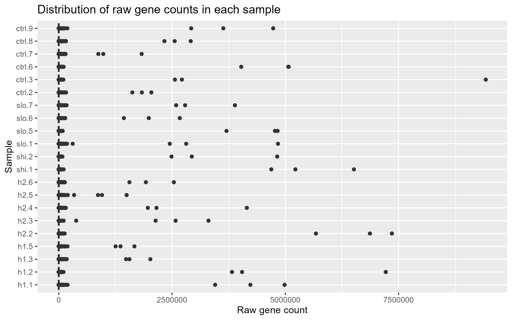
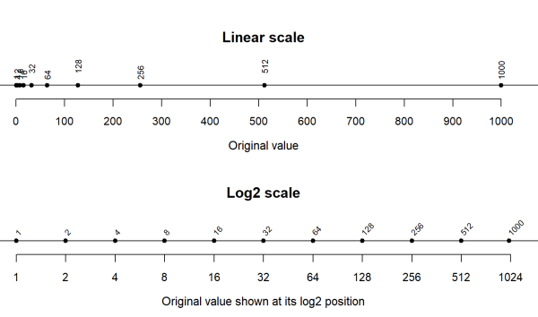

<style>
  .tooltip-text {
    text-decoration: underline dotted #4a5568 2px; /* Dotted line under the word */
    text-underline-offset: 3px;                     /* Gives space between text and line */
    cursor: help;                                  /* Changes mouse pointer to a '?' cursor */
    background-color: #f7fafc;                     /* Optional subtle background highlight */
    padding: 0 2px;
    border-radius: 2px;
  }
  
  .tooltip-text:hover {
    background-color: #e2e8f0;                     /* Highlight on mouseover */
  }
</style>

<link rel="stylesheet" href="https://unpkg.com/tippy.js@6/themes/light.css" />

# Transforming and Reshaping Data

## What you'll learn

In [Chapter 3](chapter03.qmd), we calculated the total number of counts in each sample and created a bar chart comparing library sizes. This provided an initial overview of sequencing depth but reduced each sample to a single summary value.

In this chapter, you will examine how counts are distributed across the genes in each sample. You will transform a copy of the count matrix to make its wide range of values easier to visualise, reshape the transformed data into a format suitable for `ggplot2`, and create a boxplot comparing count distributions across samples.

You will then consider the boxplot alongside the library-size plot from Chapter 3. Using more than one summary provides stronger evidence when identifying samples that may require further investigation.

::: {.callout-note title="Learning outcomes"}

By the end of this chapter, you should be able to:

- explain why the wide range of RNA-seq counts can make raw-count plots difficult to interpret
- create a log2-transformed copy of a count matrix for exploratory visualisation
- explain why a pseudocount is added before transforming zero counts
- distinguish between wide-format and long-format data
- reshape transformed count data into a format suitable for `ggplot2`
- create a boxplot comparing count distributions across samples
- combine evidence from complementary quality-control plots to identify samples that may require further investigation
- save a plot to the appropriate project output folder

**ISCB alignment:** B3 (transform and reshape life-science data for computational analysis), D3 (use complementary visual summaries to identify data that may require further investigation), E3 (manage derived figures within a reproducible folder structure), F3 (interpret count distributions and sample-level quality summaries in their biological and technical context), H3 (use basic R functions to transform, reshape, validate and visualise data using `ggplot2`).

:::

## Continuing the analysis from Chapter 3

Open the same RStudio Project and the `HAT_analysis.R` script used in Chapter 3. Add the new code from this chapter below your existing code so that the script remains a reproducible record of the analysis.

If you have restarted R, rerun your script from the beginning. This should ensure `count_data` and `sample_info` are loaded and the right type of object, and that `sample_summary` exists with the correct columns.

::: {.callout-tip collapse="true" title="Recap: Essential setup code"}
The following code recreates the objects needed in this chapter. You should already have most of it in your script from Chapters 2 and 3.

```{r}
#| label: setup
#| message: false
#| warning: false

# Import sample information
sample_info <- read.csv(
  "m_sample_info.csv",
  header = TRUE,
  row.names = 1
)

# Import counts and convert them to a numeric matrix
count_data <- read.csv(
  "m_sample_counts.csv",
  header = TRUE,
  row.names = 1
)

count_data <- as.matrix(count_data)

# Create the sample summary table
total_counts <- colSums(count_data)
sample_summary <- data.frame(
  sample_id = colnames(count_data),
  status = sample_info$status,
  total_counts = total_counts
)
```
:::

## Additional sample-quality control

In [Chapter 3](chapter03.qmd), we calculated `total_counts` as a sample-level summary and plotted it for each sample (you may also have prepared a `detected_genes` summary plot for each sample if you completed the Optional Activity).

::: {.callout-note title="Recap: Total counts per sample plot"}
```{r}
library(ggplot2)
read_plot <- ggplot(
  sample_summary,
  aes(x = sample_id, y = total_counts)
) +
  geom_col() +
  coord_flip()
  
read_plot
```
:::

The total-count plot is a useful quality-control summary, but it reduces a complete sample to a single number. If you completed the optional detected-gene activity, that plot also reduces each sample to one value.

These summaries make samples easy to compare, but they do not show how counts are distributed among the genes. For example, two samples could have the same total number of counts and a similar number of detected genes (genes with at least one observed count), but one sample might contain relatively even expression across many genes while the other is dominated by a smaller number of highly expressed genes. This is important because a sample dominated by a small number of highly expressed genes may reflect a technical problem or an important biological feature of the sample, and may affect the comparisons we make later. Plotting the distribution of counts gives us another way to identify samples that may need closer investigation before we begin the differential expression analysis. Remember:

**Garbage In, Garbage Out**.

::: {.callout-tip title="Try it yourself: Interpret the raw gene-count distribution plot"}
In the image below, we have plotted the distribution of gene counts using the raw count data.

- What makes this graph difficult to interpret?
- Where do most of the observed counts appear on the scale?



:::

::: {.callout-tip collapse="true" title="Solution"}
A small number of genes have much larger counts than most others. These are often genes that produce abundant RNA molecules, such as genes involved in protein synthesis, core cellular processes or specialised functions of the sampled tissue. In blood-derived samples, for example, haemoglobin transcripts can account for a substantial proportion of the observed counts unless reduced during library preparation using a depletion method. High counts do not automatically indicate a problem but these large values determine the scale of the count axis and make differences among most gene counts difficult to see. Conversely, zeroes may just mean that no fragments were assigned to that gene in that sample. It does not necessarily mean the gene is biologically absent or never expressed.
:::

## Transforming the counts for visualisation

Biological data often contain values that span a very wide range. This is sometimes described as having a large *dynamic range*. In RNA-seq data, many genes may have zero or relatively few counts, while a smaller number of highly expressed genes may have thousands or even millions of counts. This pattern is common in bioinformatics because biological molecules are not usually present at similar abundances. Some transcripts are required in very large quantities, while others are produced only in particular cell types, under particular conditions or at much lower levels.

We can address this by **transforming** the values before plotting them. A transformation applies the same mathematical function to every value, producing a new representation of the data. It does not remove the largest values, but changes the spacing between values so that a wide range can be displayed more clearly.

A common transformation in bioinformatics is the base-2 logarithm that can be applied to a numerical object using the `log2()` R function. On a log2 scale, each increase of one unit represents a doubling. The figure below is a comparison of the linear and log2 scales. On the linear scale, small values are compressed near zero because the axis must accommodate values as large as 1,000. On the log2 scale, each equal interval represents a doubling, allowing both small and large values to be distinguished.



::: {.callout-tip title="Try it yourself: Compare the linear and log2 scale"}
1. Why are values from 1 to 64 difficult to distinguish when the linear axis must also display much larger counts?
2. Does the log2 transformation change the order of the values, or only the spacing between them?
:::

::: {.callout-tip collapse="true" title="Solution"}
1. Values from 1 to 64 occupy only a small part of the linear axis because the plot must also accommodate much larger counts. As a result, these smaller values are compressed close together and are difficult to distinguish.
2. The transformation preserves the order of positive values but does not preserve their original distances. It compresses larger values more strongly than smaller values.
:::

We can apply a `log2` transformation to all the values in the `count_data` matrix into a new matrix called `log_count_data` using the statement:

```{r}
log_count_data <- log2(count_data + 1)
```

Because we assign the transformed values to a new matrix, the original `count_data` matrix remains unchanged.

::: {.callout-note title="Why do we add 1?"}
Before applying the log2 transformation, we add a small value of 1 to every count. This is sometimes called adding a **pseudocount**. In R, log2(0) returns -Inf, representing negative infinity. These non-finite values would make this visualisation difficult to interpret. After adding one, a raw count of zero becomes log2(0 + 1), which is zero. This keeps zero counts at zero in the transformed copy and prevents -Inf values from being produced.

Remember, in [Chapter 3](chapter03.qmd) we found that approximately 55.1% of genes had zero counts in the first sample. We therefore cannot apply log2() directly without producing many -Inf values.
:::

::: {.callout-tip title="Try it yourself: Check that the matrix structure was preserved"}
The transformation should only change the count values but preserve the organisation of the matrix. The transformed matrix should therefore contain the same number of genes and samples, with the samples in the same order.

Run the following checks:

```{r}
# Check that the matrices have the same dimensions
identical(
  dim(log_count_data),
  dim(count_data)
)

# Check that the sample identifiers remain in the same order
identical(
  colnames(log_count_data),
  colnames(count_data)
)
```

Both statements should return `TRUE`.

This confirms that `log_count_data` has the same dimensions and sample order as `count_data`. The values have changed, but their positions in the matrix have not.
:::

::: {.callout-warning title="Transformed values are for visualisation only"}
The log2-transformed values are used only to make this exploratory plot easier to read. We will not use these values for filtering, modelling or differential expression testing.

Those later steps will use the original integer counts stored in `count_data`.
:::

We have changed the values but not their positions. Next, we will change their positions but not their values by reshaping the data.

## Data formats and reshaping

The transformed counts are currently stored in a matrix because this is a convenient format for RNA-seq data. Each row represents a gene, each column represents a sample and each cell contains the transformed count for one gene in one sample. This arrangement is called **wide format** because the measurements from different samples are spread across separate columns:

Wide format is useful for storing the count data, but it is less convenient for creating this boxplot. To draw the plot, ggplot2 needs to know two things for every count:

- the value of the count
- the sample to which the count belongs

We will therefore need to reshape a copy of the data so that all the transformed counts are collected in one column and the corresponding sample names are recorded in another. This arrangement is called **long format** because the measurements from the different samples are collected into a single column:

{width="50%"}{width="30px"}{width="25%"}

Reshaping changes how the data are arranged but it does not recalculate or transform the count values. Reshaping is a common operation in bioinformatics because the same data may need to be organised differently for storage, visualisation and analysis.

::: {.callout-tip title="Try it yourself: Predict the new shape"}
This can be difficult to follow at first, so let’s practice using the small example count matrix we used in [Chapter 2](chapter02.qmd):

``` text
         sample_1  sample_2  sample_3
gene_A          5         0         8
gene_B          2         4         1
```

The matrix is in **wide format**. Each gene is stored in a row and each sample has its own column.

Imagine that we convert this matrix to a data frame and then use `stack()` to reshape it into long format.

Before looking at the solution, answer the following questions:

1.  How many count values are present in the wide data?
2.  How many rows will the long data contain?
3.  Which count values will appear in the first column?
4.  Which sample ID should be associated with each count?

Remember that `stack()` works through the first sample column, followed by the second sample column and then the third.
:::

::: {.callout-tip collapse="true" title="Solution"}
1.  The wide data contain **six count values**:

``` text
2 genes × 3 samples = 6 count values
```

2.  After reshaping, the long data will contain **six rows**. Each row contains one count value and the sample from which it came.

3.  `stack()` works down each sample column in turn. The values will therefore appear in this order `5, 2, 0, 4, 8, 1`.

4.  The counts and sample IDs will be arranged as follows:

``` text
count  sample_id
5           sample_1
2           sample_1
0           sample_2
4           sample_2
8           sample_3
1           sample_3
```
:::

**Reshaping the log2 matrix**

The log2-transformed counts are currently stored as a matrix. Before using `stack()`, we have to convert the matrix to a data frame because the `stack()` function expects its input to be organised as a data frame:

::: {.callout-tip title="Try it yourself: Convert the matrix into a data frame"}
In Chapter 2, we used the `as.matrix()` function to convert a data frame into a matrix:

``` r
count_data <- as.matrix(count_data)
```

We now want to convert a matrix in the opposite direction. The function for this is `as.data.frame()`.

Use `as.data.frame()` to complete the statement below:

``` r
log_count_data_frame <- __________________________
```

Remember, the object we want to convert is called `log_count_data`. We don't want to overwrite it so we will assign it to a new object called `log_count_data_frame`.
:::

::: {.callout-tip collapse="true" title="Solution"}
```{r}
log_count_data_frame <- as.data.frame(log_count_data)
```
:::

We now use the `stack()` function in R to reshape the wide format data frame into long format:

```{r}
count_plot_data <- stack(log_count_data_frame)
head(count_plot_data)
```

By default, `stack()` names the columns `values` and `ind`, which isn't very useful. We can replace those names with clearer ones using the `colnames()` function we have previously used:

```{r}
colnames(count_plot_data) <- c(
  "log2_count",
  "sample_id"
)

head(count_plot_data)
```

::: {.callout-warning }

The original count matrix contains one value for every gene–sample combination. Reshaping places each of these values in a separate row, so `count_plot_data` will contain more than one million rows.

This is expected. Use functions such as `head()`, `dim()` and `nrow()` to inspect the object rather than attempting to print the complete data frame.

The reshaped data retain every transformed count and its associated sample identifier. They do not retain the gene identifiers because these are not required for this sample-level boxplot. The original gene identifiers remain available in `log_count_data` and `count_data`.

:::

::: {.callout-note title="What does c() mean?"}
The `c()` function **combines values into a vector**. A vector is an ordered collection of values with the same basic type (like a list of numbers or a list of words). It is similar to one column in a spreadsheet.

Here, `c()` creates a character vector containing the two actual column names:

``` r
c("log2_count", "sample_id")
```

The complete statement assigns those names, in order, to the two columns of `count_plot_data`.
:::

:::: {.callout-tip title="Try it yourself: Was every transformed count retained?"}

The number of rows in the long data should equal:

```text
number of genes × number of samples
```

Run the following statements:

```{r}
nrow(count_plot_data)

nrow(count_data) * ncol(count_data)
```

1. Do the two results match?
2. What does this confirm, and what does it not confirm?

:::

::: {.callout-tip collapse="true" title="Solution"}

The two values should match because every entry in the original matrix produces one row in the long data.

This confirms that the long data contain the expected number of transformed values. It does not prove that the values are unchanged or correctly associated with their sample identifiers.

:::

## Create the gene-count distribution boxplot

We have now prepared the data in the structure needed for the plot. Each row of `count_plot_data` contains:

- one transformed gene-count value in `log2_count`
- the sample associated with that value in `sample_id`

This means that `ggplot2` can group together all the transformed counts belonging to the same sample. It will use those values to create one boxplot for each sample.

Each boxplot summarises the distribution of transformed counts across all genes in that sample. It shows the typical values and their spread, allowing us to compare the overall count distributions between samples. The points beyond the whiskers represent **individual gene counts**, not outlier samples. They are not automatically measurement errors.

In Chapter 3, you built a plot using this general structure:

``` r
a_plot <- ggplot(
  data = a_data_frame,
  mapping = aes(
    x = an_x_variable,
    y = a_y_variable
  )
) +
  a_geom()
```

We will reuse that structure with the new long-format data but this time, instead of using `geom_col()` to create a bar chart, we will use `geom_boxplot()`.

::: {.callout-tip title="Try it yourself: Create a boxplot"}
Complete the code by replacing the blanks with the names below. Try this without looking back first. If you get stuck, open the solution.

- `count_plot_data`
- `sample_id`
- `log2_count`

``` r
count_distribution_plot <- ggplot(
  ___________________,
  aes(x = __________, y = __________)
) +
  geom_boxplot() +
  coord_flip()

count_distribution_plot
```
:::

::: {.callout-tip collapse="true" title="Solution"}
```{r}
count_distribution_plot <- ggplot(
  count_plot_data,
  aes(x = sample_id, y = log2_count)
) +
  geom_boxplot() +
  coord_flip()

count_distribution_plot
```
:::


Compare your transformed boxplot with the raw-count distribution plot shown earlier. Because many genes have zero counts, the **median** and **lower quartile** of some samples may be zero. This is a feature of the data rather than a plotting error.

1.  In which plot is it easier to see the boxes and compare the distributions between samples?
2.  Why are most values compressed close to zero in the raw-count plot?
3.  What has the log2 transformation changed about the appearance of the data?
4.  Has the log2 transformation changed which values are relatively low or high?

The log2 transformation makes the distributions easier to visualise but samples are not expected to have identical distributions because genuine biological differences can alter gene expression. This plot can be used to identify broad or unexpected differences that should be investigated alongside other QC evidence.

The plot currently only exists as an object in the R Environment. To use the plot outside R, we can save it as an image using the `ggsave()` function. Try to recall the code from Chapter 3 to save the `count_distribution_plot` as `count_distributions_per_sample.png` into the `figures/` output directory.

::: {.callout-tip collapse="true" title="Solution"}
```{r}
ggsave(
  filename = "figures/count_distributions_per_sample.png",
  plot = count_distribution_plot
)
```
:::

## Combine the quality-control evidence

Let's bring everything together and compare the count-distribution plot with the `sample_summary` table and the library-size plot from Chapter 3.

1.  Are the count distributions broadly similar across the samples?
2.  Do the samples with higher total counts also have noticeably different count distributions?
3.  Does any sample appear consistently different across total counts and count distribution (or detected genes if you did the Optional Activity)?
4.  Based on the evidence available, is there a clear reason to exclude any sample before continuing?
5.  Why is it useful to examine several quality-control summaries rather than relying on only one?

::: {.callout-tip title="Biological interpretation"}
Differences in these plots can reflect sequencing depth and composition as well as technical or biological differences. At this stage, treat them as descriptive prompts for further investigation, not as formal criteria for removing samples. Write a short conclusion explaining how you interpret them using the following structure (you could add it as a comment in your script to remind yourself):

`# Overall, the samples show ______. Although there is some variation in ______, no sample appears ______ across all the quality-control summaries. We will therefore ______.`
:::

::: {.callout-important title="QC does not need to identify a failed sample"}
A quality-control assessment does not need to identify a failed sample. Finding no clear evidence of a problematic sample is also a useful result.
:::

## Summary

In this chapter, you examined how gene counts are distributed within each sample. Raw RNA-seq counts span a wide range, which can make their distributions difficult to compare on a linear scale. You therefore created a log2-transformed copy of the count matrix for visualisation while preserving the original integer counts for later differential-expression analysis.

You then reshaped the transformed data from wide format, where each sample occupied a separate column, into long format, where each row contained one transformed count and its associated sample identifier. This allowed you to use `ggplot2` to create a boxplot comparing count distributions across samples.

- **Transformation** values change, structure remains
- **Reshaping** structure changes, values remain

In this chapter, you:

- created a log2-transformed copy of the count matrix using `log2(count_data + 1)`
- explained why a pseudocount is added before transforming zero counts
- confirmed that transformation preserved the dimensions of the count matrix
- distinguished between wide-format and long-format data
- converted the transformed matrix into a data frame
- reshaped the transformed data using `stack()`
- checked that the reshaped data contained the expected number of values
- created a boxplot comparing count distributions across samples
- combined evidence from the library-size and count-distribution plots
- interpreted unusual patterns cautiously rather than automatically excluding samples

No single quality-control summary is sufficient to determine whether a sample should be removed. Differences between samples could reflect sequencing depth, sample composition, technical variation or genuine biology. Samples with unusual patterns should therefore be investigated using multiple sources of evidence.

The quality-control summaries provide no clear reason to exclude any samples at this stage. In the next Chapter 5, we will  return to the original integer counts and use the sample groups in `sample_info` to test for differences in gene expression.

## Optional extra activities

You have now completed the required activities for this chapter. The remaining activities are **optional** but valuable opportunities for further practice. You can attempt them now or return to them later.

::: {.callout-tip title="Optional Activity 1: Compare different transformations"}
In this tutorial, we used log2 transformation to make a large range of RNA-seq counts easier to visualise. But there are also other ways to transform data that adjust the scale and represent the data differently.

Create two additional transformed versions of `count_data`:

``` r
log10_count_data <- log10(count_data + 1)

square_root_count_data <- sqrt(count_data)
```

Choose one or both of these transformed matrices and adapt the reshaping code from earlier to create a boxplot.

Compare the new plot with the log2 transformation plot.

1.  How do the numerical axis values differ between the log2 and log10 plots?
2.  Do log2 and log10 change the ordering or relative pattern of the counts?
3.  How does the square-root plot differ visually from the logarithmic plots?
4.  Why must the axis label state which transformation was applied?
:::

::: {.callout-tip collapse="true" title="One possible approach"}
Log10-transformed counts:

```{r}
log10_count_data <- log10(count_data + 1)

log10_count_data_frame <- as.data.frame(
  log10_count_data
)

log10_count_plot_data <- stack(
  log10_count_data_frame
)

colnames(log10_count_plot_data) <- c(
  "log10_count",
  "sample_id"
)

log10_count_distribution_plot <- ggplot(
  log10_count_plot_data,
  aes(
    x = sample_id,
    y = log10_count
  )
) +
  geom_boxplot() +
  coord_flip() +
  labs(
    title = "Distribution of gene counts in each sample",
    x = "Sample",
    y = "log10(count + 1)"
  )

log10_count_distribution_plot
```

1.  Log2 and log10 produce different numerical scales because they use different bases. One is a constant rescaling of the other, so they preserve the same ordering and relative pattern among counts. The square-root transformation compresses the upper range less strongly than a logarithmic transformation.

2.  The numerical values and axis units differ because the logarithms use different bases. The axis label must therefore state which transformation was used.

3. A square-root transformation also compresses the range of the counts but less strongly than either logarithmic transformation. It produces a plot that lies between the raw-count and log-transformed plots, making the smaller values easier to distinguish but the largest counts can still have a strong effect on the scale.

4. Because the numerical values and axis units differ between transformations, the axis label must always clearly state which transformation was used.

Square root-transformed counts:

```{r}
square_root_count_data <- sqrt(count_data)

square_root_count_data_frame <- as.data.frame(
  square_root_count_data
)

square_root_count_plot_data <- stack(
  square_root_count_data_frame
)

colnames(square_root_count_plot_data) <- c(
  "sqrt_count",
  "sample_id"
)

square_root_count_plot <- ggplot(
  square_root_count_plot_data,
  aes(
    x = sample_id,
    y = sqrt_count
  )
) +
  geom_boxplot() +
  coord_flip() +
  labs(
    title = "Distribution of gene counts in each sample",
    x = "Sample",
    y = "sqrt(count)"
  )

square_root_count_plot
```
:::

<script>
  tippy('[data-tippy-content]');
</script>
