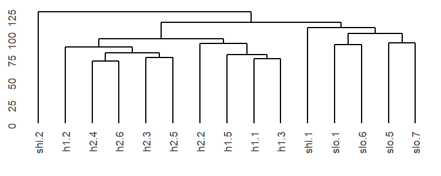
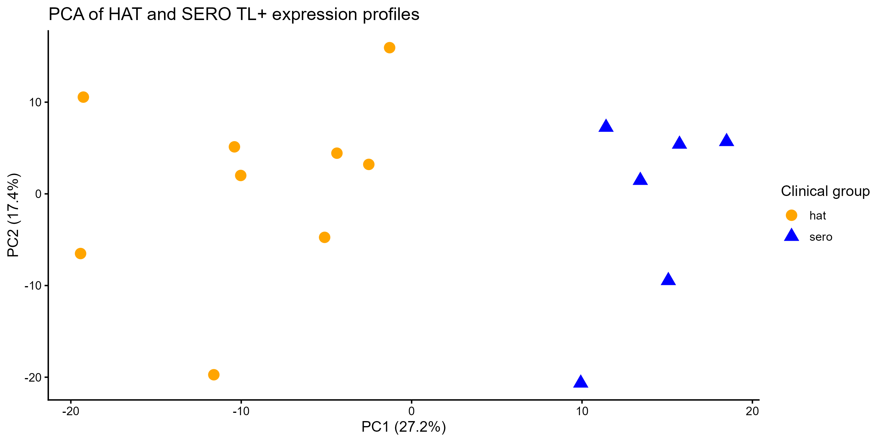
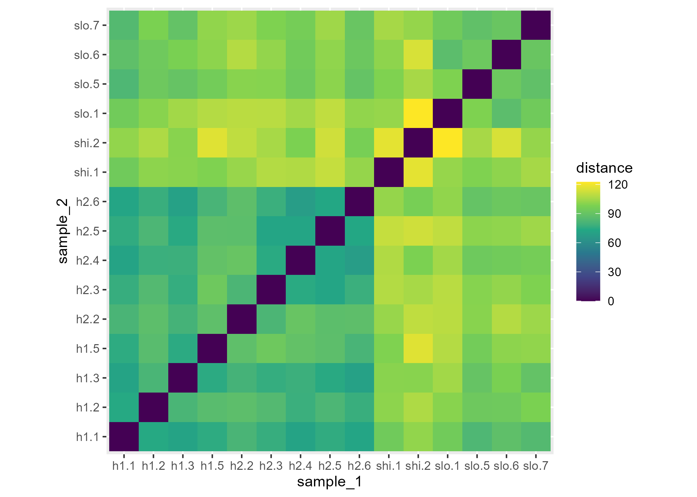

<style>
  .tooltip-text {
    text-decoration: underline dotted #4a5568 2px; /* Dotted line under the word */
    text-underline-offset: 3px;                     /* Gives space between text and line */
    cursor: help;                                  /* Changes mouse pointer to a '?' cursor */
    background-color: #f7fafc;                     /* Optional subtle background highlight */
    padding: 0 2px;
    border-radius: 2px;
  }
  
  .tooltip-text:hover {
    background-color: #e2e8f0;                     /* Highlight on mouseover */
  }
</style>
<link rel="stylesheet" href="https://unpkg.com/tippy.js@6/themes/light.css" />

# Pattern discovery, hierarchical clustering and heatmaps

## What you'll learn

In [Chapter 8](chapter08_restructured.qmd), we compared the overall expression profiles of samples. In the PCA, similar samples appeared near one another. In the sample-distance heatmap, similar samples had smaller pairwise distances.

In this chapter, we will use the same idea of similarity to arrange samples into groups. This process is called **clustering**.

Clustering does not begin with the **HAT** and **SERO TL+** labels. Instead, it groups objects according to patterns in the expression data. We can then compare the resulting groups with the known sample information. Because group labels are not used to construct the clustering, this is called <span class="tooltip-text" data-tippy-content="Unsupervised methods identify patterns in the data without using predefined outcome labels to determine the result.">unsupervised</span> clustering.

Hierarchical clustering displays relationships as a branching diagram called a **dendrogram**. Samples or genes that join at relatively low branch heights are more similar under the selected distance and linkage rules. Objects or groups that join higher in the tree are less similar.

A clustered heatmap combines three types of information:

- the coloured cells show expression values;
- the column order shows relationships among samples;
- the row order shows relationships among genes.

::: {.callout-important}
Remember, clustering can reveal structure that is consistent with status but it cannot show that disease status caused that structure.
:::

::: {.callout-note title="Learning outcomes"}
By the end of this chapter, you should be able to:

- distinguish between selecting genes using statistical evidence and ordering samples and genes using hierarchical clustering
- explain why gene-expression values are standardised within each gene for a pattern-focused heatmap
- use a sample dendrogram to determine heatmap column order
- construct and interpret a heatmap in which samples and genes are ordered using hierarchical clustering
- explain how gene selection, scaling, distance and linkage affect the resulting visualisation
- prepare a reproducible matrix for gene clustering in the next chapter

**ISCB alignment:** A3 (interpret clustering and expression patterns in
their biological and experimental context), C3 (use unsupervised pattern
discovery to generate cautious biological hypotheses), D3 (apply and compare
Euclidean distance, hierarchical clustering, dendrograms and standardised
heatmaps for high-dimensional RNA-seq data), E3 (validate intermediate
objects and save documented figures, tables and reusable analysis objects),
F3 (use appropriate clustering and visualisation tools for exploratory
bioinformatics analysis), H3 (select, transform, reshape, order and visualise
expression data in R), K3 (communicate clustering patterns and their
limitations without treating visual groups as independent or causal
evidence).
:::

## Retrieve the previous analysis objects

We will continue to use the objects created in earlier chapters that should already be available in your R environment.

::: {.callout-tip collapse="true" title="Recap: If the objects are not available"}
```{r}
#| message: false
#| warning: false

library(DESeq2)
library(ggplot2)

# Load the fitted model created previously
dds_fitted <- readRDS("results/objects/dds_fitted.rds")

# Retrieve aligned sample information
sample_info <- as.data.frame(colData(dds_fitted))

# Recreate the HAT-versus-SERO TL+ result
res_hat_vs_sero <- results(
  dds_fitted,
  contrast = c("status", "hat", "sero"),
  alpha = 0.05
)

# Create a results data frame with stable gene identifiers
result_data <- data.frame(
  gene_id = rownames(res_hat_vs_sero),
  as.data.frame(res_hat_vs_sero),
  row.names = NULL
)

# Sort result_data
result_data <- result_data[
  order(result_data$padj, na.last = TRUE),
]

# Add readable gene symbols
annotation_data <- read.csv(
  "human_annotations_from_orgHs.csv",
  check.names = FALSE,
  stringsAsFactors = FALSE
)

symbol_column <- if ("SYMBOL_SAFE" %in% colnames(annotation_data)) {
  "SYMBOL_SAFE"
} else {
  "SYMBOL"
}

result_data$symbol <- annotation_data[[symbol_column]][
  match(result_data$gene_id, annotation_data$ENSEMBL)
]

missing_symbol <- is.na(result_data$symbol) | result_data$symbol == ""
result_data$symbol[missing_symbol] <- result_data$gene_id[missing_symbol]

# Transform counts for exploratory visualisation
vsd <- vst(dds_fitted, blind = FALSE)
vst_values <- assay(vsd)

# Retain the two groups used in this comparison
selected_samples <- rownames(sample_info)[
  sample_info$status %in% c("hat", "sero")
]

selected_vst <- vst_values[
  ,
  selected_samples
]

selected_vsd <- vsd[
  ,
  selected_samples
]

selected_info <- sample_info[
  selected_samples,
]

selected_info$status <- droplevels(selected_info$status)
```
:::

## Hierarchical clustering

In [Chapter 8](chapter08_restructured.qmd), each point in the PCA represented a sample and the sample-distance heatmap represented every pairwise sample comparison. **Hierarchical clustering** uses the same general distance information but presents it as a branching tree.

::: {.callout-tip title="Try it yourself: Clustering without R"}
This can be difficult to follow at first, so let’s practise with a small example data frame and your own intuition:

```text
         sample_1 sample_2 sample_3 sample_4
gene_A       2        3        8        9
gene_B       3        3        9        8
```

1. Which two samples look most similar?
2. Which other two samples look similar?
3. If you divided the samples into two groups, what would they be?
4. How could you represent the sequence in which the samples were grouped?
:::

::: {.callout-note collapse="true" title="Solution"}
1. `sample_1` and `sample_2` look the most similar. Gene A differs by 1 and Gene B has the same value in both samples.

2. `sample_3` and `sample_4` also look similar. Both samples have relatively high values for Gene A and Gene B.

3. A possible grouping might involve two groups where:

   - **Group 1:** contains `sample_1` and `sample_2`
   - **Group 2:** contains `sample_3` and `sample_4`

4. The sequence can be represented using a tree or **dendrogram**:

```text
          ┌─ sample_1
      ┌───┤
      │   └─ sample_2
──────┤
      │   ┌─ sample_3
      └───┤
          └─ sample_4
```

Samples that join at a lower height are more similar according to the measurements used for clustering. The two larger groups join at a higher height because their profiles are less similar.

The groups were identified from the expression values. We did not use predefined sample labels to construct them.
:::

In real RNA-seq data, each sample is described by expression measurements for thousands of genes. We therefore use a summary **distance measure** to summarise the difference between every pair of sample profiles.

::: {.callout-tip title="Try it yourself: Predict before running"}
Before constructing the dendrogram, use the [Chapter 8](chapter08_restructured.qmd) PCA and sample-distance heatmap to predict what the clustering might show. Discuss these questions with a partner before revealing the solution:

1. Did the HAT and SERO TL+ samples form separate, overlapping or unclear groups in the PCA?
2. Which samples do you predict will join at relatively low heights in the dendrogram?
3. Do you expect all samples with the same status to be equally similar? Why or why not?
4. If one sample does not appear where you expect, what information should be checked before drawing a conclusion?

:::

::: {.callout-tip title="Solution" collapse="true"}
1. The PCA suggested some separation between HAT and SERO TL+ samples, so samples with the same status may appear more often within the same larger branches.

2. Samples that appeared close in the PCA, or had small pairwise distances, may join at relatively low heights.

3. Samples with the same status will not necessarily be equally similar. Biological variation, sample composition, technical variation and other measured or unmeasured factors can contribute to differences among individuals.

4. An unexpected position does not automatically make a sample incorrect or unusable. We should compare the dendrogram with the PCA, pairwise distances, sample metadata, quality-control information and processing information before drawing a conclusion.
:::

## Reuse the Chapter 8 sample distances

In Chapter 8, we transposed the VST matrix so that samples were in rows and then we calculated the Euclidean distances between samples. We can use a similar statement to recreate the distance object required by `hclust()`, although we do not need to convert the result into a matrix because `hclust()` uses the `dist` object directly.

```{r}
# Extract VST values for the selected HAT and SERO TL+ samples
selected_vst <- assay(selected_vsd)

# Transpose and place samples in rows
sample_by_gene <- t(selected_vst)

# Calculate the distance between every pair of samples
sample_dist <- dist(sample_by_gene)

# Inspect the first few distances
head(sample_dist)
```

A smaller distance represents more similar expression profiles. 

## Build the sample dendrogram

Hierarchical clustering begins with each sample in its own group. It repeatedly joins samples or groups according to their distance until all samples are connected.

```{r}
# Cluster samples using complete linkage
sample_hclust_all_genes <- hclust(
  sample_dist,
  method = "complete"
)
```

By default, `hclust()` uses a **complete linkage** method to calculate distances between groups of samples. Complete linkage compares groups using their most distant pair of samples. Other linkage methods are available and may produce different dendrograms, so the method used should be recorded when reporting the analysis. 

## Plot the dendrogram

We can now draw the dendrogram. Unfortunately, `ggplot2` doesn't have a method for drawing dendrograms but the `ggdendro` package provides a `ggdendrogram()` helper function. It takes the specialised object created by `hclust()` and displays it as a figure that is compatible with `ggplot2`.

This is similar to our previous use of the `ggrepel` package. Rather than calculating all the label positions ourselves, we used the `geom_label_repel()` helper to position labels clearly. Here, `ggdendrogram()` handles the branch and sample-label positions needed to display a dendrogram.

First we have to load the package:

```{r}
library(ggdendro)
```

We can now create and store the dendrogram using the familiar `ggplot2` format:

```{r}
#| message: false
#| warning: false
# Create a ggplot2-compatible dendrogram
sample_dendrogram <- ggdendrogram(
  sample_hclust_all_genes,
  rotate = FALSE
)
```

The argument `rotate = FALSE` places the sample labels along the bottom of the dendrogram. Changing this to `rotate = TRUE` would display the dendrogram horizontally.

The dendrogram is stored as a `ggplot2` object called `sample_dendrogram`. This means that it can be displayed and modified similarly to the other `ggplot2` objects:

```r
# Add a title to the dendrogram
sample_dendrogram <- sample_dendrogram +
  labs(
    title = "Hierarchical clustering of samples"
  )
  
# Display the dendrogram
sample_dendrogram

```

In the dendrogram:

- Each sample name at the bottom is the end of a branch
- Samples that join at relatively low heights have more similar profiles
- Samples or groups that join at higher heights are less similar
- The vertical merge height represents distance under the selected linkage rule
- Horizontal position is not a numerical measurement
- Branches can be rotated without changing which samples are grouped together

A dendrogram describes relationships but does not prove that a branch is a distinct biological subtype.

::: {.callout-tip title="Try it yourself: Interpret the three different views of the samples"}



::: {layout-ncol=2}

{#fig-pca-example}

{#fig-distance-heatmap-example}

:::

With a partner, compare the dendrogram with the PCA plot and sample-distance
heatmap from the previous session.

1. Do the main branches of the dendrogram broadly correspond to sample status? Identify any samples that do not follow the main pattern.

2. What does the dendrogram show more clearly than the PCA plot or sample-distance heatmap?

3. Why might the dendrogram, PCA plot and sample-distance heatmap show similar but not identical patterns?
   
:::

::: {.callout-tip collapse="true" title="Possible answers"}

1. The main branches may broadly correspond to sample status, although not every sample necessarily follows the dominant pattern. Samples within the same status group can still differ because of biological or technical variation.

2. The dendrogram makes the nested grouping of samples particularly clear. It shows which samples cluster first and how smaller groups combine into larger groups. The sample-distance heatmap shows the pairwise distances more directly, while the PCA plot shows the major directions of variation in a reduced number of dimensions.

3. The three visualisations summarise the expression data in different ways. The dendrogram uses the selected distance and linkage methods, the sample-distance heatmap displays pairwise distances, and PCA represents the major directions of variation. They may therefore reveal related but not identical patterns.

:::

## Joining sample clustering to a gene-expression heatmap

The sample dendrogram describes broad relationships among samples using **all retained genes** from the samples in the HAT-versus-SERO TL+ comparison.

To explore the underlying data further, we can use clustering to construct a gene-expression heatmap. This heatmap will show how genes prioritised by the HAT-versus-SERO TL+ differential-expression analysis behave across individual samples.

While the all-gene sample dendrogram we have made describes **broad relationships among samples**, this new heatmap will describe how genes **vary across individual samples**.

In this section:

- the **samples** will be ordered using the hierarchical clustering calculated from all retained VST-transformed genes
- the **selected genes** will be clustered using their standardised expression patterns across the samples

The resulting heatmap will show both the sample-clustering order and the gene-clustering order. In the next chapter, we will divide the gene dendrogram into discrete gene-expression signatures.

::: {.callout-warning title="Gene selection affects the question"}

The heatmap genes are selected using the HAT-versus-SERO TL+ statistical comparison. Separation by status in the resulting heatmap is therefore expected and is not independent confirmation of the differential-expression result.

The heatmap is still useful for examining:

- whether individual samples follow the broad pattern
- whether there is variation within the status groups
- whether the selected genes appear to contain one dominant response or several different patterns

It should not be presented as proof that the sample groups were discovered without using status information.

:::

## Select genes for the overview heatmap

A heatmap containing every gene would be difficult to interpret. We will use the 150 genes with the smallest adjusted p-values.

We can use the filtering and ordering approach from previous chapters to construct this reduced data set from the `result_data` object. This is already sorted from the smallest to the largest adjusted p-values so the `head()` function can be used to select the 150 genes with the lowest adjusted p-values: 

```{r}
# Use head to select the 150 genes with lowest adjusted p-values
overview_genes <- head(
  result_data,
  150
)

head(overview_genes)
```

## Extract the expression values

We can then use the Ensembl gene identifiers to retrieve the corresponding rows from the `selected_vst` that contains the **variance-stabilising transformed** values. Remember, these are transformed expression values where the relationship between a gene's average expression and its variability is reduced, while also accounting for differences in sequencing depth.

```{r}
overview_matrix <- selected_vst[
  overview_genes$gene_id,
]
# Check the dimensions:
dim(overview_matrix)
```

The matrix should contain:

- 150 genes in rows
- one column for every selected sample
- VST expression values in the cells

## Standardise expression within each gene

Genes can have very different overall expression levels but we want the heatmap colour to show whether a sample has relatively high or low expression for that gene. To do that, we can **standardise** the expression values within each gene by converting them to **z-scores**.

::: {.callout-note collapse="true" title="How z-scores are calculated"}

Z-scores are transformed values commonly used to compare relative expression patterns. Here, they are used for clustering and visualisation, not for differential-expression testing or for comparing absolute expression between genes.

You do not need to memorise the formula or calculate z-scores manually.

$$
z = \frac{x - \bar{x}}{s}
$$

where:

- $x$ is the expression value for one sample;
- $\bar{x}$ is the mean expression of that gene across samples;
- $s$ is the standard deviation of that gene across samples.

For example, if a gene has a mean of 10 and a standard deviation of 2,
an expression value of 12 has a z-score of:

$$
z = \frac{12 - 10}{2} = 1
$$

This means that the value is one standard deviation above that gene's mean.

::: 

This can be difficult to follow at first but imagine that a gene has expression values of 8, 10 and 12 across three samples. The mean expression of the gene is 10 in this dataset. The value 8 is below that gene’s mean, 10 is near its mean, and 12 is above its mean.

Row standardisation converts these relationships into a value called a **z-score**:

- **Negative z-scores** are below that gene’s mean in the dataset
- **Near zero z-scores** are close to that gene’s mean in the dataset
- **Positive z-scores** are above that gene’s mean in the dataset

A z-score does not represent absolute expression. Because each gene is standardised separately, z-scores should not be used to compare the absolute expression levels of different genes.

The supplied code standardises each gene in the `overview_matrix` separately and stores it in a new `overview_z` object. The two uses of `t()` temporarily place genes in columns, allowing `scale()` to standardise each gene across samples. **You do not need to memorise the nested code**. 

```{r}
overview_z <- t(
  scale(
    t(overview_matrix)
  )
)
```

We can check that the dimensions have not changed by using:

```{r}
dim(overview_matrix)
dim(overview_z)
```

::: {.callout-note collapse="true" title="Why are there two uses of `t()`?"}

`scale()` operates on matrix columns but our genes are stored in rows.

1. The first `t()` temporarily places genes in columns.
2. `scale()` standardises each gene.
3. The second `t()` restores genes to rows.

:::

## Cluster genes by expression pattern

When constructing the dendrogram, we clustered samples using their expression profiles across genes. We can also change the unit of analysis and cluster genes using their standardised expression patterns across samples.

In the `overview_z` object that contains z-score standardised data:

- genes are stored in rows
- samples are stored in columns

The `dist()` function compares rows. Applying it to `overview_z` therefore means it calculates the distances between genes and no additional transpose is required.

```{r}
# Calculate distances between gene-expression patterns
gene_dist <- dist(
  overview_z
)

# Cluster genes using complete linkage
gene_hclust <- hclust(
  gene_dist,
  method = "complete"
)
```

The `gene_hclust` object records how genes with similar standardised expression patterns are clustered using the distance between them. We will not display the complete gene dendrogram because it contains 150 gene labels and would be difficult to read. Instead, we will just use the dendrogram to determine the order of the gene rows in the heatmap.

## Retrieve the sample and gene orders

The sample and gene clustering objects each store an ordering of the labels in their `hclust` object.

To investigate patterns in the RNA-seq data, we can use:

- the sample order to arrange the heatmap columns
- the gene order to arrange the heatmap rows

The `sample_order` and `gene_order` can be extracted from the `hclust` objects using the following code:

```{r}
sample_order <- sample_hclust_all_genes$labels[
  sample_hclust_all_genes$order
]

gene_order <- gene_hclust$labels[
  gene_hclust$order
]
```

## Prepare the heatmap plotting data

The standardised expression values are stored as z-scores in `overview_z`, with genes in rows and samples in columns.

To create the heatmap, we need to:

1. reshape the matrix into one row per heatmap tile
2. apply the sample order from the sample dendrogram
3. apply the gene order from the gene dendrogram

The following is supplied preparation code. Run the complete block, but focus on what each stage accomplishes rather than memorising the code. It is all based on concepts we have looked at in previous chapters.

```{r}
# Convert the matrix into one row per gene-sample combination using as.table()
heatmap_data <- as.data.frame(
  as.table(overview_z)
)

# Change the column names to be more informative 
colnames(heatmap_data) <- c(
  "gene_id",
  "sample_id",
  "z_score"
)

# Order columns using the sample dendrogram
heatmap_data$sample_id <- factor(
  heatmap_data$sample_id,
  levels = sample_order
)

# Order rows using the gene dendrogram
heatmap_data$gene_id <- factor(
  heatmap_data$gene_id,
  levels = rev(gene_order)
)

# Inspect the new dataframe
head(heatmap_data)
```

Each row now represents one heatmap tile:

- `gene_id` identifies the gene
- `sample_id` identifies the sample
- `z_score` determines the tile colour

## Construct the clustered expression heatmap

We can now use `geom_tile()` to construct the heatmap, just as we did for the sample-distance heatmap in Chapter 8:

```{r}
expression_heatmap <- ggplot(
  heatmap_data,
  aes(
    x = sample_id,
    y = gene_id,
    fill = z_score
  )
) +
  geom_tile()

expression_heatmap
```

In this plot:

- the horizontal axis identifies the samples
- the vertical axis represents the selected genes
- the fill colour represents the row z-score
- each tile represents one gene in one sample

The order of the heatmap axes has already been set in `heatmap_data`:

- **Columns**: samples are arranged according to the sample dendrogram.
- **Rows**: genes are arranged according to the gene dendrogram.

This places samples and genes from similar dendrogram branches near one another, making expression patterns easier to see.

We can now add the viridis colour scale and informative sample labels and make some other modifications to make the figure easier to understand:

```{r}
expression_heatmap <- expression_heatmap +
  scale_fill_viridis_c(
    name = "Row z-score"
  ) +
  labs(
    title = "Expression patterns among selected genes",
    x = "Sample",
    y = "Gene"
  ) +
  theme(
    axis.text.x = element_text(
      angle = 45,
      hjust = 1
    ),
    axis.text.y = element_blank(),
    axis.ticks.y = element_blank()
  )

expression_heatmap
```

::: {.callout-warning}
It is best to hide the individual gene labels in this figure because 150 labels would be too small to read. Their order is still retained and follows the gene dendrogram.
::: 

In this colour scale, lower z-scores indicate relatively low expression for a gene and higher z-scores indicate relatively high expression for that gene. The colours do not represent absolute expression or allow direct comparison of expression levels between different genes.

::: {.callout-tip title="Try it yourself: Interpret the clustered expression heatmap"}

With a partner, discuss the following questions.

1. What does one tile represent?
2. What do the colours indicate?
3. What determines the order of the sample columns?
4. What determines the order of the gene rows?
5. Do broad groups of genes show contrasting patterns between HAT and
   SERO TL+ samples?
6. Do all samples within each status group show identical patterns?
7. Write a short conclusion explaining whether the heatmap can establish whether a group of genes has a shared biological function. Use the following structure (you could add it as a comment in your script to remind yourself):

Use this structure:

`# The clustered heatmap shows _____. The sample columns are ordered by _____, while the gene rows are ordered by _____. Broad groups of genes appear to _____. However, the heatmap cannot establish _____.`

:::

::: {.callout-note collapse="true" title="Possible answers"}

1. Each tile represents the row-standardised expression value for one gene in one sample.

2. In the default Viridis colour scheme, darker blue colours represent lower row z-scores and lighter yellow colours represent higher row z-scores. Negative values are below that gene’s mean, values near zero are near its mean and positive values are above its mean. Use the legend to connect specific colours with z-score values.

3. The sample columns follow the sample dendrogram, which was calculated using all retained VST-transformed genes.

4. The gene rows follow the gene dendrogram, which was calculated from the row-standardised expression patterns of the selected genes.

5. Broad groups of genes may show contrasting relative expression patterns between HAT and SERO TL+ samples. These patterns identify groups of genes that could be investigated further.

6. No. Samples within the same status group may show similar broad patterns without having identical values. This reflects variation among biological samples.

7. The clustered heatmap shows broad differences in the relative expression patterns of the selected genes across the samples. The sample columns are ordered by hierarchical clustering using all retained VST-transformed genes, while the gene rows are ordered by hierarchical clustering of their row-standardised expression patterns. Broad groups of genes appear to show contrasting patterns between HAT and SERO TL+ samples. However, the heatmap cannot establish that genes with similar expression patterns have a shared biological function. Functional annotation or enrichment analysis would be needed to investigate this possibility.

:::

## Save the expression heatmap

The expression heatmap currently only exists as an object in the R Environment. To use the plot outside R, we can save it as an image using the `ggsave()` function. Try and recall the code we have used previously to save the `expression_heatmap` object as `clustered_expression_heatmap.png` in the `figures` output folder.

::: {.callout-note collapse="true" title="Solution"}

```{r}
ggsave(
  filename = "figures/clustered_expression_heatmap.png",
  plot = expression_heatmap
)
```
::: 

## Summary

In this chapter, you:

- constructed and interpreted a sample dendrogram
- compared PCA, pairwise distances and hierarchical clustering
- selected and row-standardised genes for a pattern-focused heatmap
- clustered genes using their expression patterns across samples
- ordered the heatmap columns and rows using the sample and gene dendrograms
- interpreted and saved the clustered expression heatmap

**Sample clustering** compared overall expression profiles among samples.
**Gene clustering** compared the standardised expression patterns of selected genes. 

The sample clustering was unsupervised because it used all retained genes without using the status labels. The gene-clustering algorithm also did not directly use status labels, but the genes supplied to it were selected using the HAT-versus-SERO TL+ comparison. The selected-gene heatmap is therefore not an independent unsupervised discovery of status separation.

The gene dendrogram shows nested relationships among genes, but it does not
yet define discrete gene-expression signatures. We will investigate this further in the next session.

## Optional extra activities

You have now completed the required activities for this chapter. The remaining section is an **optional, but valuable** challenge for further practice. You can attempt it now or return to it later.

::: {.callout-tip title="Optional Activity 1: title="Extension: Create a labelled heatmap" collapse="true"}

The overview heatmap is useful for identifying broad expression patterns, but
it does not show the names of individual genes.

In this extension, you will repeat the same heatmap workflow using 50 genes
with readable gene symbols:

1. select genes using adjusted p-values;
2. standardise expression within each gene;
3. cluster genes by their standardised expression patterns;
4. order the samples and genes using their dendrograms;
5. display the gene symbols on the heatmap.

This heatmap asks a more focused question:

> Which individual genes show the broad expression patterns visible in the
> overview heatmap?

### Select 50 genes with readable symbols

First, retain genes that have both a non-missing adjusted p-value and a
readable gene symbol:

```{r}
labelled_heatmap_genes <- result_data[
  !is.na(result_data$padj) &
    !is.na(result_data$symbol) &
    result_data$symbol != "",
]
```

Order the genes by adjusted p-value:

```{r}
labelled_heatmap_genes <- labelled_heatmap_genes[
  order(labelled_heatmap_genes$padj),
]
```

Select the first 50 genes:

```{r}
labelled_heatmap_genes <- head(
  labelled_heatmap_genes,
  50
)
```

More than one stable gene identifier can occasionally share the same gene
symbol. Create unique display labels so that every heatmap row has a distinct
label:

```{r}
labelled_heatmap_genes$display_symbol <- make.unique(
  labelled_heatmap_genes$symbol
)
```

The adjusted p-values determine **which genes are selected**. Hierarchical
clustering will determine **the order in which they appear** in the heatmap.

### Extract and standardise the expression values

Extract the VST-transformed expression values for the selected genes:

```{r}
labelled_matrix <- selected_vst[
  labelled_heatmap_genes$gene_id,
  ,
  drop = FALSE
]
```

Check the dimensions of the resulting matrix:

```{r}
dim(labelled_matrix)
```

The matrix should contain 50 rows, one for each selected gene.

Standardise the expression values within each gene:

```{r}
labelled_z <- t(
  scale(
    t(labelled_matrix)
  )
)
```

The row z-scores describe expression relative to each gene's own mean:

- negative values indicate expression below that gene's mean;
- values near zero indicate expression near that gene's mean;
- positive values indicate expression above that gene's mean.

Check that standardisation has not changed the dimensions:

```{r}
dim(labelled_z)
```

### Cluster the selected genes

The genes are stored in the rows of `labelled_z`. Therefore, `dist()`
calculates distances between genes:

```{r}
labelled_gene_dist <- dist(
  labelled_z
)
```

Cluster genes with similar standardised expression patterns using complete
linkage:

```{r}
labelled_gene_hclust <- hclust(
  labelled_gene_dist,
  method = "complete"
)
```

The resulting dendrogram determines the order of the gene rows in the
labelled heatmap.

### Prepare the plotting data

The following supplied code performs several preparation steps:

1. retrieves the gene order from the new gene dendrogram;
2. converts the matrix into one row per gene-sample combination;
3. associates each stable gene identifier with a readable symbol;
4. applies the sample and gene dendrogram orders.

You do not need to memorise this code. Focus on what the resulting objects
control:

- `sample_order` controls the heatmap columns;
- `labelled_gene_order` controls the heatmap rows.

```{r}
# Retrieve the gene order from the new gene dendrogram
labelled_gene_order <- labelled_gene_hclust$labels[
  labelled_gene_hclust$order
]

# Convert the matrix into one row per gene-sample combination
labelled_plot_data <- as.data.frame(
  as.table(labelled_z)
)

# Give the columns informative names
colnames(labelled_plot_data) <- c(
  "gene_id",
  "sample_id",
  "z_score"
)

# Convert the identifiers to character values before matching
labelled_plot_data$gene_id <- as.character(
  labelled_plot_data$gene_id
)

labelled_plot_data$sample_id <- as.character(
  labelled_plot_data$sample_id
)

labelled_heatmap_genes$gene_id <- as.character(
  labelled_heatmap_genes$gene_id
)

labelled_gene_order <- as.character(
  labelled_gene_order
)

# Match each stable gene identifier to its display symbol
labelled_plot_data$gene_symbol <-
  labelled_heatmap_genes$display_symbol[
    match(
      labelled_plot_data$gene_id,
      labelled_heatmap_genes$gene_id
    )
  ]

# Convert the clustered gene identifiers into display symbols
labelled_symbol_order <-
  labelled_heatmap_genes$display_symbol[
    match(
      labelled_gene_order,
      labelled_heatmap_genes$gene_id
    )
  ]

# Apply the sample dendrogram order to the heatmap columns
labelled_plot_data$sample_id <- factor(
  labelled_plot_data$sample_id,
  levels = sample_order
)

# Apply the gene dendrogram order to the heatmap rows
labelled_plot_data$gene_symbol <- factor(
  labelled_plot_data$gene_symbol,
  levels = rev(labelled_symbol_order)
)
```

The samples and genes are now arranged in the same way as in the overview
heatmap:

- the sample columns follow the sample dendrogram;
- the gene rows follow the labelled-gene dendrogram.

Inspect the prepared data:

```{r}
head(labelled_plot_data)
```

Each row contains:

- one gene symbol;
- one sample identifier;
- one row-standardised expression value.

There are 50 genes and 15 samples, so the plotting data should contain:

$$
50 \times 15 = 750
$$

rows.

Check the dimensions:

```{r}
dim(labelled_plot_data)
```

Check that every gene has a readable label:

```{r}
sum(
  is.na(labelled_plot_data$gene_symbol)
)
```

This should return `0`.

### Construct the labelled heatmap

Construct the heatmap using the same Viridis scale and plotting approach as
the overview heatmap:

```{r}
#| label: fig-labelled-expression-heatmap
#| fig-width: 11
#| fig-height: 10

labelled_heatmap <- ggplot(
  labelled_plot_data,
  aes(
    x = sample_id,
    y = gene_symbol,
    fill = z_score
  )
) +
  geom_tile() +
  scale_fill_viridis_c(
    name = "Row z-score"
  ) +
  labs(
    title = "Expression patterns among selected genes",
    subtitle = paste(
      "Samples and genes are ordered",
      "using hierarchical clustering"
    ),
    x = "Sample",
    y = "Gene",
    caption = paste(
      "Values show expression relative to each gene's mean.",
      "Gene symbols are displayed for 50 prioritised genes."
    )
  ) +
  theme_minimal() +
  theme(
    panel.grid = element_blank(),
    axis.text.x = element_text(
      angle = 45,
      hjust = 1
    ),
    axis.text.y = element_text(
      size = 7
    ),
    plot.caption = element_text(
      hjust = 0
    )
  )

labelled_heatmap
```

### Compare the two heatmaps

Before looking at the suggested solution, think about the following questions:

1. Which broad patterns are easier to see in the 150-gene overview heatmap?
2. Which individual genes are easier to investigate in the labelled heatmap?
3. Does reducing the number of genes alter the apparent sample pattern?
4. What is gained and lost by displaying individual gene symbols?
5. Why might the gene order differ between the two heatmaps?
6. Do the two heatmaps provide independent evidence of differences between
   HAT and SERO TL+ samples? Why or why not?

::: {.callout-note collapse="true" title="Possible answers"}

1. The 150-gene overview heatmap includes more information and may make large
   groups of genes with similar expression patterns easier to identify.

2. The labelled heatmap makes it possible to identify individual genes
   associated with particular expression patterns.

3. The broad sample pattern may remain similar, but some details may change
   because the labelled heatmap uses a smaller set of genes.

4. Displaying gene symbols makes individual genes easier to identify, but it
   limits how many genes can be shown clearly and can make broad patterns
   harder to see.

5. The heatmaps contain different sets of genes. Hierarchical clustering is
   calculated separately for each set, so the gene distances, dendrogram
   branches and resulting row orders may differ.

6. No. Both heatmaps use genes selected from the same HAT-versus-SERO TL+
   differential-expression comparison. They visualise patterns among
   prioritised genes but do not provide independent evidence of differences
   between the status groups.

:::

### Save the labelled heatmap

Save the optional heatmap to the `figures` directory:

```{r}
ggsave(
  filename = "figures/clustered_expression_heatmap_with_labels.png",
  plot = labelled_heatmap,
)
```

:::

::: {.callout-tip title="Optional Actvity 2: Add the sample dendrogram to the heatmap" collapse="true"}

The sample dendrogram and expression heatmap show related information:

- the dendrogram shows the relationships among samples;
- the heatmap shows the standardised expression patterns;
- the order of the heatmap columns follows the leaves of the sample
  dendrogram.

In this extension, you will use `patchwork` to place the sample dendrogram
directly above the corresponding heatmap columns.

### Load the required packages

We will use:

- `ggdendro` to convert the hierarchical-clustering result into data that
  can be plotted with `ggplot2`;
- `patchwork` to arrange the dendrogram and heatmap vertically.

Install these packages once if they are not already installed:

```r
install.packages("ggdendro")
install.packages("patchwork")
```

Load the packages:

```{r}
library(ggdendro)
library(patchwork)
```

### Prepare the dendrogram data

The sample clustering is stored in:

```r
sample_hclust_all_genes
```

Convert this clustering result into data that can be plotted with
`ggplot2`:

```{r}
sample_dendrogram_data <- dendro_data(
  sample_hclust_all_genes,
  type = "rectangle"
)
```

The horizontal position of each dendrogram leaf corresponds to the position
of a sample in `sample_order`.

### Construct the sample dendrogram

Use the segment information to draw the dendrogram:

```{r}
sample_dendrogram_aligned <- ggplot(
  segment(sample_dendrogram_data)
) +
  geom_segment(
    aes(
      x = x,
      y = y,
      xend = xend,
      yend = yend
    ),
    linewidth = 0.5
  ) +
  scale_x_continuous(
    limits = c(
      0.5,
      length(sample_order) + 0.5
    ),
    expand = c(0, 0)
  ) +
  scale_y_continuous(
    expand = expansion(
      mult = c(0, 0.05)
    )
  ) +
  labs(
    y = "Distance"
  ) +
  theme_minimal() +
  theme(
    panel.grid = element_blank(),
    axis.title.x = element_blank(),
    axis.text.x = element_blank(),
    axis.ticks.x = element_blank(),
    plot.margin = margin(
      t = 5,
      r = 5,
      b = 0,
      l = 5
    )
  )

sample_dendrogram_aligned
```

The sample labels are omitted from the dendrogram because they will be shown
on the heatmap below.

### Construct a heatmap for the combined figure

Construct the heatmap using the same data, sample order and Viridis scale as
the main heatmap:

```{r}
heatmap_aligned <- ggplot(
  heatmap_data,
  aes(
    x = sample_id,
    y = gene_id,
    fill = z_score
  )
) +
  geom_tile() +
  scale_x_discrete(
    expand = expansion(
      add = 0.5
    )
  ) +
  scale_fill_viridis_c(
    name = "Row z-score"
  ) +
  labs(
    x = "Sample",
    y = "Selected genes"
  ) +
  theme_minimal() +
  theme(
    panel.grid = element_blank(),
    axis.text.x = element_text(
      angle = 45,
      hjust = 1
    ),
    axis.text.y = element_blank(),
    axis.ticks.y = element_blank(),
    plot.margin = margin(
      t = 0,
      r = 5,
      b = 5,
      l = 5
    )
  )

heatmap_aligned
```

The dendrogram and heatmap use the same sample order:

- the dendrogram leaves follow `sample_order`;
- the heatmap columns use `sample_order` as their factor-level order.

The x-axis limits also provide half a position of space on either side. This
helps align the centres of the dendrogram leaves with the centres of the
heatmap columns.

### Combine the dendrogram and heatmap

Use the `/` operator from `patchwork` to place the dendrogram above the
heatmap:

```{r}
#| label: fig-heatmap-with-sample-dendrogram
#| fig-width: 11
#| fig-height: 9

heatmap_with_dendrogram <- (
  sample_dendrogram_aligned /
    heatmap_aligned
) +
  plot_layout(
    heights = c(1, 4)
  ) +
  plot_annotation(
    title = "Clustered expression patterns across samples"
  )

heatmap_with_dendrogram
```

The values supplied to `heights` determine how the available vertical space
is divided:

```r
heights = c(1, 4)
```

This gives one part of the available height to the dendrogram and four parts
to the heatmap.

### Check the alignment

Examine the combined figure and consider:

1. Does each dendrogram leaf align with the centre of a heatmap column?
2. Can you follow major dendrogram branches into corresponding groups of
   heatmap columns?
3. Does adding the dendrogram make the sample relationships easier to
   interpret?
4. Is the dendrogram large enough to read without taking too much space from
   the heatmap?
5. What information does the dendrogram add that is not shown by the heatmap
   alone?

::: {.callout-note collapse="true" title="Possible answers"}

1. Each dendrogram leaf should align with the centre of one heatmap column
   because both panels use the same sample order.

2. Major dendrogram branches should correspond to adjacent groups of
   heatmap columns. The heatmap can then be used to examine the expression
   patterns associated with those branches.

3. The dendrogram makes the hierarchical relationships among the samples
   explicit. The heatmap alone displays the samples in clustered order but
   does not show where branches join.

4. The relative panel heights can be changed if either panel is difficult to
   read. For example, `heights = c(1.5, 4)` would provide more space for the
   dendrogram.

5. The dendrogram shows the nested grouping of samples and the relative
   heights at which branches join. The heatmap shows the standardised
   expression patterns underlying the visual comparison.

:::

### Save the combined figure

```{r}
ggsave(
  filename = "figures/heatmap_with_sample_dendrogram.png",
  plot = heatmap_with_dendrogram
)
```

:::

<script>
  tippy('[data-tippy-content]');
</script>
